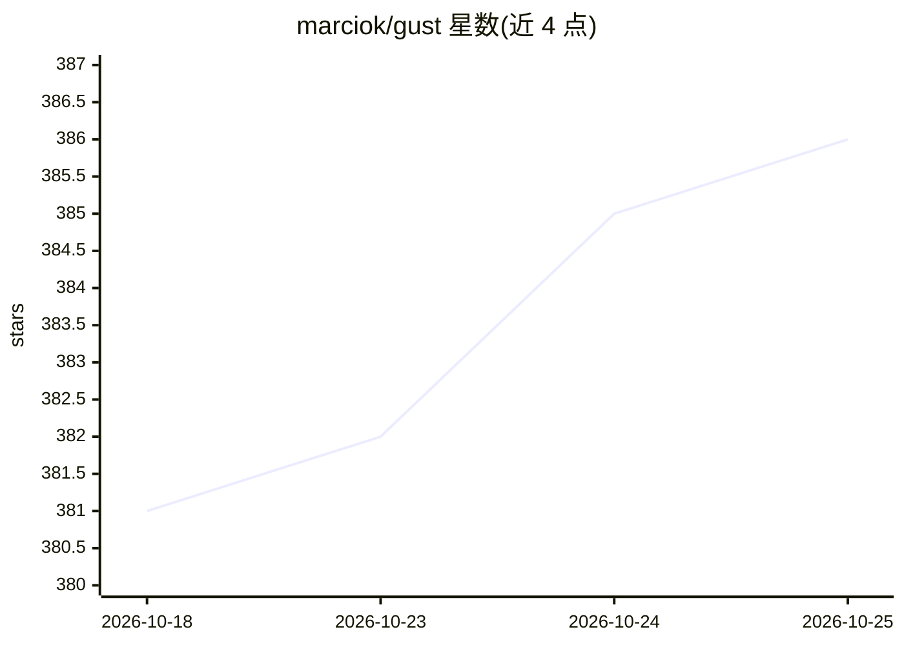

# marciok/gust

⭐ 386 · Elixir · MIT · 推送 2026-10-20 · [GitHub](https://github.com/marciok/gust) · 个人维护

**Erlang VM 上的任务编排引擎：DAG 调度与 Web 监控**

基于 Elixir/Erlang VM 的任务编排系统：通过 Gust DSL、YAML 或 Python 编写 DAG，保存到 dags/ 目录即被加载，支持 Cron 式调度、依赖感知 DAG、并行 map_over、条件跳过、wait_for 暂停、重试与状态恢复，并提供 Web UI 实时监控、运行控制与 secrets 编辑。面向需要轻量替代多组件调度系统的开发者；单系统即可运行，可选 Docker 快速启动。内置 MCP Server 供 LLM 客户端列出/触发/调试 DAG。

## 筛选速览

| 维度 | 判定 | 备注 |
|---|---|---|
| AI 角色 | `ai-enhanced` | 去掉 AI 部分产品仍成立 |
| 许可风险 | `permissive` | MIT |
| 部署形态 | `None` |  |
| 模型依赖 | — | README 未给出锁定关系 |
| 硬件要求 | — | 无带数字的原话,不猜 |
| 安装摩擦 | `low` | 无编译、无系统依赖或容器化 |
| 成熟度 | — | 结构信号不足 |

## 能力要点

- Elixir DSL / YAML / Shell / Python 多方式编写 DAG
- Cron 调度、依赖感知、map_over 并行、wait_for 暂停等任务控制
- 重试退避、损坏状态恢复与 Web UI 实时监控
- 内置 MCP Server，LLM 客户端可触发与调试 DAG

## 适用场景

- 编排 ETL 数据流水线与定时任务
- 用 Web UI 监控与手动控制 DAG 运行
- 让 Claude/Codex 等 MCP 客户端直接触发和调试工作流

## 场景标签

`工作流自动化` · 领域:效率与自动化

## 证据(README 行号)

> L47: From code to running workflow: you (or your agent) write a DAG, save it in the `dags/` folder, and Gust picks it up
> L79: GustWeb includes a built-in MCP server that gives your LLM access to Gust’s core features, including listing DAGs, 

## 星数曲线

2026-10-18 381 → 2026-10-25 386（+5）

---
*卡片 v1 · prompt 1.4 · 生成 2026-10-21 · 置信度 high · 依据 README sha `200e058cdf8f` · [字段定义](../../DATASET.md)*
