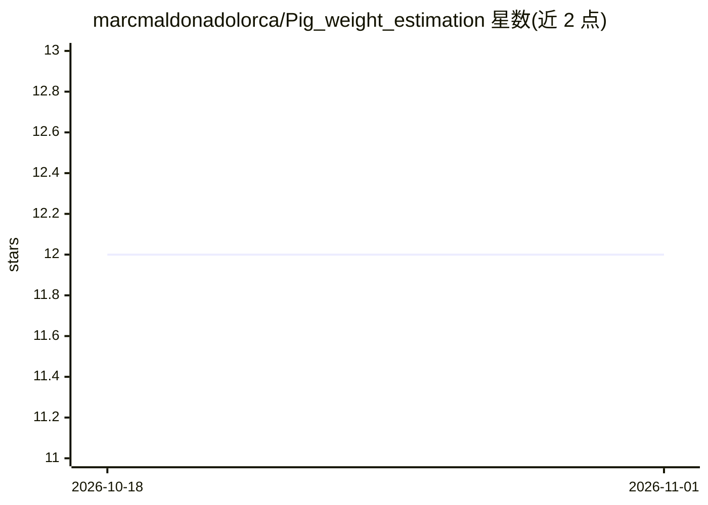

# marcmaldonadolorca/Pig_weight_estimation

⭐ 12 · Python · MIT · 推送 2026-10-25 · [GitHub](https://github.com/marcmaldonadolorca/Pig_weight_estimation) · 个人维护

**从深度图像估计猪体重的本科毕业论文项目（无需称重）**

BSc 学位论文代码库（UAB，评分 9.2/10）：用养殖场头顶深度相机帧估计活猪体重，替代人工称重。流水线为 YOLOv5 检测 / U-Net 语义分割（IoU 0.98）、Open3D 点云与 Poisson 网格重建、CNN（InceptionV3，ktrain）回归，验证集 MAE 3.6 kg。README 明确说明验证为按图像的随机划分（同一动物出现在训练与验证两侧）、未做交叉验证，指标对新动物偏乐观；农场数据不可再分发，仓库仅含代码与报告，依赖锁定在 2021 年版本（Python 3.8、TensorFlow 2.7、PyTorch 1.10）。

## 筛选速览

| 维度 | 判定 | 备注 |
|---|---|---|
| AI 角色 | `ai-native` | 本体是模型或模型工具 |
| 许可风险 | `permissive` | MIT |
| 部署形态 | `library` | 以包/库形式分发 |
| 模型依赖 | — | README 未给出锁定关系 |
| 硬件要求 | — | 无带数字的原话,不猜 |
| 安装摩擦 | `low` | 无编译、无系统依赖或容器化 |
| 成熟度 | — | 结构信号不足 |

## 能力要点

- U-Net 分割（InceptionV3 编码器，IoU 0.98 / accuracy 0.99）
- CNN 回归在分割、居中、去头部掩码后达验证 MAE 3.6 kg
- Open3D 点云与 Poisson 网格重建 3D 表面
- README 详细披露验证协议局限与运行环境问题（glibc 2.41、Arial.ttf 重定向）

## 适用场景

- 智慧养殖场景下无接触估计猪只体重
- 复现或参考基于深度图的体重回归流水线
- 学习深度图分割与 CNN 回归的完整代码组织

## 场景标签

 · 领域:计算机视觉/精准畜牧

## 证据(README 行号)

> L3: Estimating pig weight **without a scale**, from overhead depth images. This was my BSc
> L18: |Weight regression (CNN on segmented, centred depth, head excluded)|MAE (validation)|**3.6 kg**|
> L39: 4. **Regression**: feature-based linear baseline, then CNN regression (InceptionV3 via

## 星数曲线

2026-10-18 12 → 2026-11-01 12（+0）

---
*卡片 v1 · prompt 1.4 · 生成 2026-11-01 · 置信度 high · 依据 README sha `f4a4e79e9244` · [字段定义](../../DATASET.md)*
