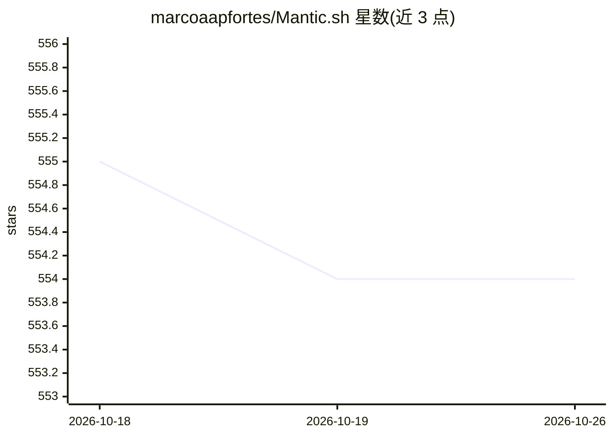

# marcoaapfortes/Mantic.sh

⭐ 554 · TypeScript · MIT · 推送 2026-07-13 · [GitHub](https://github.com/marcoaapfortes/Mantic.sh) · [官网](https://www.npmjs.com/package/mantic.sh) · 个人维护

**为 AI agent 提供的相关性优先的结构化代码搜索/MCP 服务器**

本地运行的上下文感知代码搜索引擎，面向 AI agent 与开发者：通过意图分析、路径结构评分、CamelCase 检测与可选的本地嵌入语义重排（transformers.js）对文件做相关性排序，另提供 Tree-sitter 驱动的跨仓 go-to-definition、find references、影响分析与会话上下文延续。可作为 MCP 服务器接入 Claude Desktop、Cursor、VS Code，也提供 CLI（npx 直接运行）与 Agent Rules 集成。完全本地运行、无数据外传；官方说明在 10 万+ 文件的超大仓库上存在速度取舍。

## 筛选速览

| 维度 | 判定 | 备注 |
|---|---|---|
| AI 角色 | `ai-ecosystem` | LLM/agent 周边工具 |
| 许可风险 | `permissive` | MIT |
| 部署形态 | `library` | 以包/库形式分发 |
| 模型依赖 | — | README 未给出锁定关系 |
| 硬件要求 | — | 无带数字的原话,不猜 |
| 安装摩擦 | `low` | 无编译、无系统依赖或容器化 |
| 成熟度 | — | 结构信号不足 |

## 能力要点

- 基于文件结构与元数据的意图推断与相关性排序，输出 JSON 含置信度与 token 估算
- 本地嵌入（transformers.js）语义重排：--semantic 可查概念相关代码
- Tree-sitter 代码智能：跨仓 goto/definitions 与 references
- 可作为 MCP 服务器接入 Claude Desktop、Cursor、VS Code

## 适用场景

- 让编码 agent 在写代码前用 mantic 自动检索上下文、减少 token 消耗
- 按意图查找文件（如“支付逻辑在哪”）并查看影响范围
- 在 monorepo 中跨仓库定位符号定义与引用

## 场景标签

`语义搜索` · 领域:知识与检索

## 证据(README 行号)

> L41: Mantic is an infrastructure layer designed to remove unnecessary context retrieval overhead for AI agents. It infer
> L163: Mantic works as an MCP (Model Context Protocol) server for Claude Desktop, Cursor, VS Code, and other MCP-compatib
> L163: Mantic works as an MCP (Model Context Protocol) server for Claude Desktop, Cursor, VS Code, and other MCP-compatib

## 星数曲线

2026-10-18 555 → 2026-10-26 554（-1）

---
*卡片 v1 · prompt 1.4 · 生成 2026-10-21 · 置信度 high · 依据 README sha `d5067a84ebab` · [字段定义](../../DATASET.md)*
