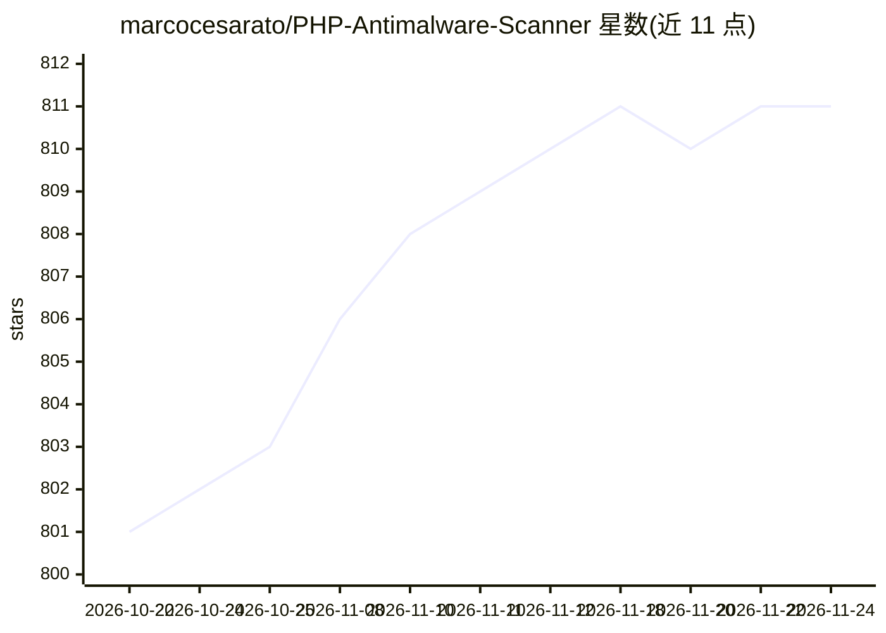

# marcocesarato/PHP-Antimalware-Scanner

⭐ 811 · PHP · GPL-3.0 · 推送 2026-11-15 · [GitHub](https://github.com/marcocesarato/PHP-Antimalware-Scanner) · [官网](https://marcocesarato.github.io/PHP-Antimalware-Scanner/) · 个人维护

**面向 PHP 项目管理员的恶意代码扫描与完整性核查工具**

AMWScan 是用于扫描 PHP 项目与 WordPress 站点的命令行工具：检测已知恶意软件签名、漏洞利用模式、危险函数调用，并对 WordPress、Laravel、Symfony 等 12 类平台做发布包校验和完整性比对。提供 Full/Lite/Signatures/Exploits/Functions 五种模式、白名单复用与报告输出。可选的 AI 评审功能在检出后咨询 LLM 判断片段是否误报，默认关闭且仅作参考。独立 scanner 文件可直接运行，也可经 Composer 或 Docker 安装。

## 筛选速览

| 维度 | 判定 | 备注 |
|---|---|---|
| AI 角色 | `ai-enhanced` | 去掉 AI 部分产品仍成立 |
| 许可风险 | `viral` | GPL-3.0 |
| 部署形态 | `self-host` | docker 或自建部署 |
| 模型依赖 | locked-api |  |
| 硬件要求 | — | 无带数字的原话,不猜 |
| 安装摩擦 | `low` | 无编译、无系统依赖或容器化 |
| 成熟度 | — | 结构信号不足 |

## 能力要点

- 支持签名/漏洞模式/危险函数/平台完整性等多类检查
- 五种扫描模式与 HTML 报告输出
- 支持 12 类 PHP 框架/平台的官方发布包完整性校验
- 可选接入 OpenAI/Anthropic/Gemini 及本地 CLI 提供商做 AI 评审

## 适用场景

- 定期扫描服务器上的 PHP 项目排查恶意代码
- 核查 WordPress 站点文件是否被篡改
- 对检出的可疑片段做 AI 辅助误报判断

## 场景标签

`网络安全` · 领域:学习与行业

## 证据(README 行号)

> L96: ## GenAI-assisted finding review
> L98: AMWScan can ask an AI provider whether each detected code fragment is likely malware, a false positive, or uncertai
> L100: AI review is disabled by default. Enable one provider with `--ai-provider`.

## 星数曲线

2026-10-22 801 → 2026-11-24 811（+10）

---
*卡片 v1 · prompt 1.4 · 生成 2026-11-24 · 置信度 high · 依据 README sha `882231980f9b` · [字段定义](../../DATASET.md)*
