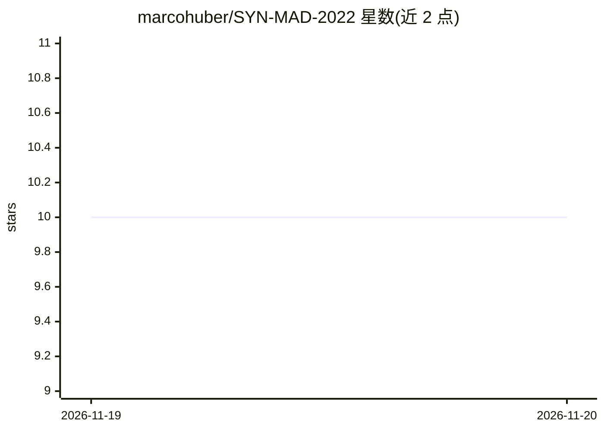

# marcohuber/SYN-MAD-2022

⭐ 10 · 推送 2026-11-09 · [GitHub](https://github.com/marcohuber/SYN-MAD-2022) · 组织维护

**人脸变形攻击检测竞赛的数据与基准发布仓库**

IJCB 2022 上举办的 SYN-MAD-2022 竞赛官方仓库，主题为基于隐私感知合成训练数据的人脸变形攻击检测。仓库提供竞赛训练数据 SMDD 的申请入口及配套的边界框、面部关键点标注文件，并发布评测基准 MAD22（基于 FRLL 数据集，含 4483 张变形图像与 204 张真实图像、五种变形方法）。数据需通过邮件向组织者申请；README 说明 2026 年 11 月起 Google Drive 上的部分数据已被移除，需重新邮件索取。

## 筛选速览

| 维度 | 判定 | 备注 |
|---|---|---|
| AI 角色 | `ai-knowledge` | 知识聚合/清单类 |
| 许可风险 | `none` | — |
| 部署形态 | `None` |  |
| 模型依赖 | — | README 未给出锁定关系 |
| 硬件要求 | — | 无带数字的原话,不猜 |
| 安装摩擦 | `low` | 无编译、无系统依赖或容器化 |
| 成熟度 | — | 结构信号不足 |

## 能力要点

- 提供 SMDD 合成训练数据的边界框与面部关键点标注文件
- 发布 MAD22 评测基准：4483 张变形图像 + 204 张真实图像，含 3 种关键点法与 2 种 GAN 变形方法
- 数据通过邮件向 Fraunhofer 组织者申请，附 BibTeX 引用信息

## 适用场景

- 申请竞赛训练数据与 MAD22 基准用于变形攻击检测研究
- 获取标注文件复现或评测人脸变形检测模型
- 引用竞赛总结论文时查阅引用信息

## 场景标签

`模型评测` `人脸识别` · 领域:评测与运维

## 证据(README 行号)

> L3: This is the repository for the IJCB-SYN-MAD-2022: Competition on Face Morphing Attack Detection Based on Privacy-awa
> L8: The synthetic training data that the competitors were allowed to use for training the morphing detectors was limited
> L25: For the evaluation of the submissions a new benchmark, MAD22 has been created by the organizers of the competition.

## 星数曲线

2026-11-19 10 → 2026-11-20 10（+0）

---
*卡片 v1 · prompt 1.4 · 生成 2026-11-19 · 置信度 high · 依据 README sha `0c057b4f1679` · [字段定义](../../DATASET.md)*
