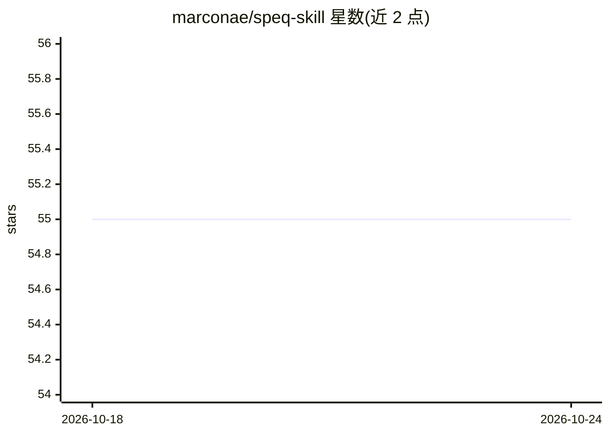

# marconae/speq-skill

⭐ 55 · Rust · MIT · 推送 2026-10-23 · [GitHub](https://github.com/marconae/speq-skill) · 个人维护

**给 Claude Code/Codex 的规格驱动开发工作流插件**

以 Rust 编写 CLI（speq）加技能插件的组合，为 Claude Code、Codex 及兼容 AI 编码代理提供规格驱动开发工作流：mission→plan→implement→record 循环，将规格以小文件形式存入项目内永久 spec 库，代理按需列表与读取相关规格以减少上下文占用；技能以语义锚点（London School TDD、BLUF、ADR 等命名方法论）约束代理行为。另提供 PR 流水线技能与可选 Serena/Context7 MCP 配合。本插件仅提供工作流结构与规格管理，代码与规格均由编码代理生成。

## 筛选速览

| 维度 | 判定 | 备注 |
|---|---|---|
| AI 角色 | `ai-ecosystem` | LLM/agent 周边工具 |
| 许可风险 | `permissive` | MIT |
| 部署形态 | `None` |  |
| 模型依赖 | — | README 未给出锁定关系 |
| 硬件要求 | — | 无带数字的原话,不猜 |
| 安装摩擦 | `low` | 无编译、无系统依赖或容器化 |
| 成熟度 | — | 结构信号不足 |

## 能力要点

- mission→plan→implement→record 可重复循环，规格增量合并进永久 spec 库
- CLI 按需列表/读取规格，避免将全部规格载入上下文窗口
- 语义锚点（London School TDD、BLUF、ADR）将技能锚定到已有方法论
- /speq:plan-pr 与 /speq:implement-pr 组成基于 PR 的代理工作流

## 适用场景

- 在 Claude Code 或 Codex 中用规格驱动流程开发功能
- 为项目沉淀可复用、按需加载的架构与功能规格库
- 通过 PR 评论留在环内，让代理完成规划、实现与记录

## 场景标签

`编码 Agent` `提示工程` · 领域:Agent 开发

## 证据(README 行号)

> L49: It combines skills with a simple CLI called `speq` that lists and reads the permanent spec library. The coding agen
> L99: `speq-skill` is a plugin for Claude Code, Codex, and other compatible AI coding agents. This project provides workf

## 星数曲线

2026-10-18 55 → 2026-10-24 55（+0）

---
*卡片 v1 · prompt 1.4 · 生成 2026-10-24 · 置信度 high · 依据 README sha `746016719b58` · [字段定义](../../DATASET.md)*
