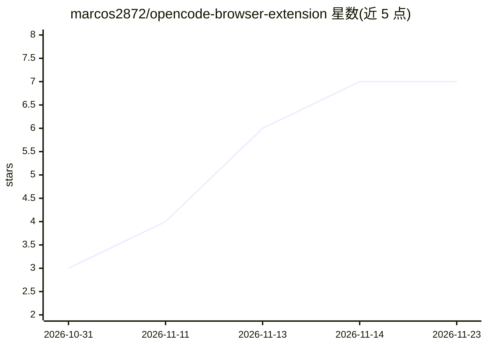

# marcos2872/opencode-browser-extension

⭐ 7 · TypeScript · MIT · 推送 2026-11-18 · [GitHub](https://github.com/marcos2872/opencode-browser-extension) · 个人维护

**把 Chrome 接入本地 OpenCode 的浏览器扩展：本地模型聊天+隔离标签页浏览**

由两部分组成的 MV3 浏览器扩展：Side panel 提供聊天界面、模型选择、工具卡片与权限管理，经本地 API v2 与 OpenCode 服务通信；OpenCode 插件向 agent 暴露 18 个 browser_* 工具，通过 WebSocket 与扩展交互，使 agent 在一组隔离标签页中浏览、读取并操作页面，操作需用户确认。全部通信限于 127.0.0.1 回环。需 Node.js 20+、Chrome/Chromium 116+ 与已安装的 OpenCode v2，从源码构建后在 chrome://extensions 手动加载。

## 筛选速览

| 维度 | 判定 | 备注 |
|---|---|---|
| AI 角色 | `ai-native` | 本体是模型或模型工具 |
| 许可风险 | `permissive` | MIT |
| 部署形态 | `library` | 以包/库形式分发 |
| 模型依赖 | — | README 未给出锁定关系 |
| 硬件要求 | — | 无带数字的原话,不猜 |
| 安装摩擦 | `low` | 无编译、无系统依赖或容器化 |
| 成熟度 | — | 结构信号不足 |

## 能力要点

- 向 OpenCode agent 暴露 18 个 browser_* 浏览器操作工具
- 所有通信限于 127.0.0.1 本地回环，数据不出本机
- agent 浏览操作在隔离标签页组中进行，且需用户确认
- 提供配对流程（opencode pair）与站点黑名单、权限控制

## 适用场景

- 让本地 OpenCode agent 打开网页并总结内容（如新闻摘要）
- 用本地模型聊天并代为完成表单填写等页面操作
- 在不上传数据的前提下为 agent 增加浏览器能力

## 场景标签

`浏览器自动化` · 领域:效率与自动化

## 证据(README 行号)

> L9: > Extensão MV3 que conecta o Chrome ao OpenCode instalado na sua máquina: usa os
> L10: > modelos locais para conversar e dá ao agente um grupo de abas isolado para
> L17: |**Extensão**|Side panel com chat, seletor de modelos, cards de ferramenta e permissões; service worker que fala co
> L18: |**Plugin**|Plugin do OpenCode que expõe as ferramentas `browser_*` ao agente e conversa com a extensão por WebSock

## 星数曲线

2026-10-31 3 → 2026-11-23 7（+4）

---
*卡片 v1 · prompt 1.4 · 生成 2026-11-20 · 置信度 high · 依据 README sha `6f8a444488e4` · [字段定义](../../DATASET.md)*
