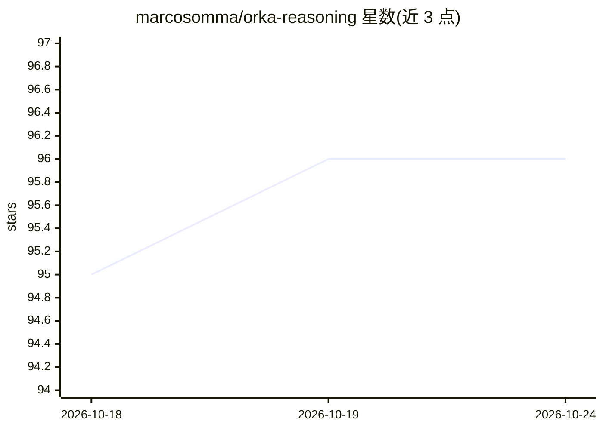

# marcosomma/orka-reasoning

⭐ 96 · Python · Apache-2.0 · 推送 2026-07-07 · [GitHub](https://github.com/marcosomma/orka-reasoning) · [官网](https://orkacore.com/) · 个人维护

**YAML 驱动的本地优先 AI 工作流编排框架（已停止维护）**

OrKa 是开源的、本地优先的 agent 编排系统：用 YAML 声明式配置定义 agent 与控制流（路由、fork/join、循环、failover、计划校验），单命令运行，内置向量检索与衰减的内存系统，支持本地与云端 LLM 后端及成本控制，提供可视化拖拽构建器（OrKa UI）、GraphScout 路径发现（beta）与可观测性追踪。维护者声明已于上月停止开发，称其为个人试验场而非生产就绪产品，将不再维护，鼓励 fork。

## 筛选速览

| 维度 | 判定 | 备注 |
|---|---|---|
| AI 角色 | `ai-ecosystem` | LLM/agent 周边工具 |
| 许可风险 | `permissive` | Apache-2.0 |
| 部署形态 | `library` | 以包/库形式分发 |
| 模型依赖 | — | README 未给出锁定关系 |
| 硬件要求 | — | 无带数字的原话,不猜 |
| 安装摩擦 | `low` | 无编译、无系统依赖或容器化 |
| 成熟度 | `idea` | |

## 能力要点

- YAML 声明式定义 agent 工作流，单命令运行
- 路由、fork/join、循环、failover、计划校验等控制流节点
- 内置向量检索与衰减机制的记忆系统
- 本地与云端 LLM 后端支持及成本控制、可观测性追踪

## 适用场景

- 用配置文件快速搭建多 agent 推理与事实核查流程
- 本地优先地运行可复现、可追踪的 agentic 工作流
- fork 后在其编排基础上做二次开发（项目已停止维护）

## 场景标签

`Agent 框架` `多智能体` `RAG` · 领域:Agent 开发

## 证据(README 行号)

> L52: OrKA-reasoning is a open-source, local‑first, YAML‑driven system for composing AI workflows. Define agents and cont
> L58: - Local and cloud LLM support with cost controls > see Backends

## 星数曲线

2026-10-18 95 → 2026-10-24 96（+1）

---
*卡片 v1 · prompt 1.4 · 生成 2026-10-23 · 置信度 high · 依据 README sha `c9640e9077b5` · [字段定义](../../DATASET.md)*
