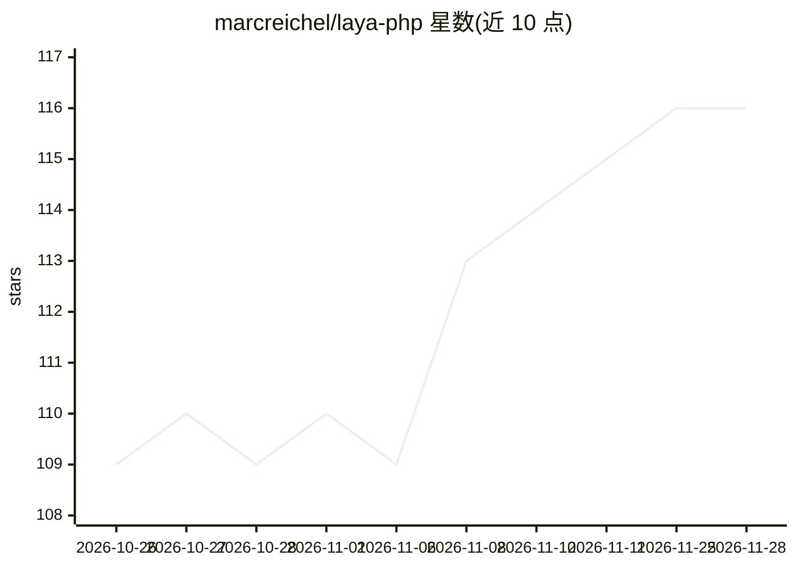

# marcreichel/laya-php

⭐ 116 · PHP · Apache-2.0 · 推送 2026-11-23 · [GitHub](https://github.com/marcreichel/laya-php) · [官网](https://packagist.org/packages/marcreichel/laya-php) · 个人维护

**PHP/Laravel SDK：接入 Laya 决策引擎，本地分类文本**

面向 PHP 8.4+ 与 Laravel 13+ 的 SDK，通过 PSR-18 客户端与 HTTP 服务 laya-serve 通信，对文本提出 choice/score/yes-no 三类问题，返回类型化的枚举、整数与布尔结果，附带置信度与弃权阈值机制。文本在自托管服务器上处理，不经外部 API。提供 Laravel 服务提供者、Eloquent cast、artisan 命令（健康检查、试运行、评测）与测试 fake；laya-serve 本身以 Docker 运行。

## 筛选速览

| 维度 | 判定 | 备注 |
|---|---|---|
| AI 角色 | `ai-ecosystem` | LLM/agent 周边工具 |
| 许可风险 | `permissive` | Apache-2.0 |
| 部署形态 | `self-host` | docker 或自建部署 |
| 模型依赖 | — | README 未给出锁定关系 |
| 硬件要求 | — | 无带数字的原话,不猜 |
| 安装摩擦 | `low` | 无编译、无系统依赖或容器化 |
| 成熟度 | — | 结构信号不足 |

## 能力要点

- typed 决策类：readonly class + enums 直接得到实例
- 校准置信度与 per-bucket 弃权阈值，低置信转人工
- Laravel 集成：自动发现、AsDecision cast、Decides 校验规则、三个 artisan 命令
- 内置 Laya::fake 支持无服务器单元测试

## 适用场景

- 工单自动分派部门并标记流失风险
- 对低置信度结果转人工复核
- 把分类决策存入 JSON 字段并读回
- 表单验证规则中直接调用文本分类

## 场景标签

 · 领域:NLP/文本分类基础设施

## 证据(README 行号)

> L11: **Classify text in PHP without paying for an LLM API.** Route support tickets, spot churn risk and score urgency, i
> L27: Under the hood this is an SDK for Laya, a multilingual decision engine that answers typed questions (`choice`, `sco
> L37: PHP 8.4+. You also need a PSR-18 HTTP client (Guzzle, Symfony HttpClient, …). The SDK finds the installed one autom

## 星数曲线

2026-10-26 109 → 2026-11-28 116（+7）

---
*卡片 v1 · prompt 1.4 · 生成 2026-11-28 · 置信度 high · 依据 README sha `5bdea9d7dcad` · [字段定义](../../DATASET.md)*
