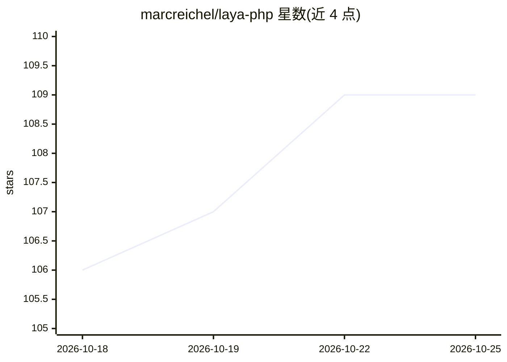

# marcreichel/laya-php

⭐ 109 · PHP · Apache-2.0 · 推送 2026-10-24 · [GitHub](https://github.com/marcreichel/laya-php) · [官网](https://packagist.org/packages/marcreichel/laya-php) · 个人维护 · 中文 README

**PHP/Laravel 的 Laya 文本决策 SDK：自托管分类替代 LLM API**

面向 PHP 8.4+/Laravel 13+ 开发者的 SDK，通过任意 PSR-18 客户端连接自托管的 laya-serve HTTP 服务器，对 100+ 语言的文本做 choice/score/yes-no 三类类型化决策（枚举、整数、布尔），支持置信度阈值、弃答门控、按语言路由 checkpoint、长文截断控制与批处理（实验性）。Laravel 侧提供服务提供者、artisan 命令（health/try/eval）、验证规则、Eloquent 转换与测试 fake。laya-serve 兼容 TypeSafe 的 /v1/systemone 协议，因此也可作为 Jev API 的自托管替代，但未针对托管的 Jev API 测试。

## 筛选速览

| 维度 | 判定 | 备注 |
|---|---|---|
| AI 角色 | `ai-ecosystem` | LLM/agent 周边工具 |
| 许可风险 | `permissive` | Apache-2.0 |
| 部署形态 | `self-host` | docker 或自建部署 |
| 模型依赖 | — | README 未给出锁定关系 |
| 硬件要求 | — | 无带数字的原话,不猜 |
| 安装摩擦 | `low` | 无编译、无系统依赖或容器化 |
| 成熟度 | — | 结构信号不足 |

## 能力要点

- 以 readonly 类 + 枚举描述决策，decide() 返回类型化实例
- 答案带校准的 answerConfidence，可按阈值转人工；laya-serve 端可按类型/选项数设定弃答阈值
- Laravel 集成：laya:health/try/eval 命令、Decides 验证规则、AsDecision 模型转换、Laya::fake 单元测试
- 附 compose.yaml 可本地启动 laya-serve（上游 Laya v0.4.6）

## 适用场景

- 在 PHP 应用中对工单做部门分派、流失风险与紧急度打分
- 自托管运行文本分类，不调用按 token 计费的 LLM API
- 为 Laravel 表单添加基于决策模型的验证规则
- 低置信度答案按阈值转人工处理

## 场景标签

 · 领域:NLP/文本分类工具

## 证据(README 行号)

> L27: Under the hood this is an SDK for Laya, a multilingual decision engine that answers typed questions (`choice`, `sco
> L29: **Looking for Jev?** `laya-serve` speaks the same `POST /v1/systemone` protocol as TypeSafe's hosted Jev API, with 

## 星数曲线

2026-10-18 106 → 2026-10-25 109（+3）

---
*卡片 v1 · prompt 1.4 · 生成 2026-10-23 · 置信度 mid · 依据 README sha `be218f92fa2b` · [字段定义](../../DATASET.md)*
