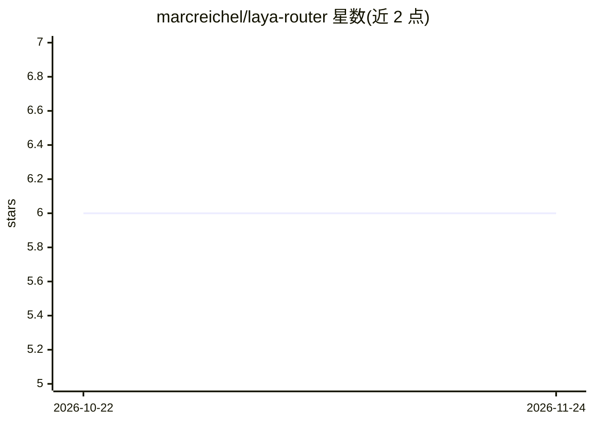

# marcreichel/laya-router

⭐ 6 · TypeScript · MIT · 推送 2026-11-13 · [GitHub](https://github.com/marcreichel/laya-router) · [官网](https://www.youtube.com/watch?v=9XJRytvBujM) · 个人维护

**为 Claude Code 会话按首条提示自动路由 Anthropic 模型的插件**

以 Claude Code 插件（mod）形式运行：根据会话首条提示在本地（laya-serve）分类为 trivial/routine/hard/research 四档，分别路由到 Haiku、Sonnet、Opus 或可选的 Fable，并按档位设置 effort。仅在首个提示时路由一次以避免破坏提示缓存；置信度低于阈值或服务不可达时回退到 /model；任务超载模型时建议而非自动切换；保留最近 1000 条路由日志供校准。

## 筛选速览

| 维度 | 判定 | 备注 |
|---|---|---|
| AI 角色 | `ai-ecosystem` | LLM/agent 周边工具 |
| 许可风险 | `permissive` | MIT |
| 部署形态 | `self-host` | docker 或自建部署 |
| 模型依赖 | locked-api |  |
| 硬件要求 | — | 无带数字的原话,不猜 |
| 安装摩擦 | `low` | 无编译、无系统依赖或容器化 |
| 成熟度 | — | 结构信号不足 |

## 能力要点

- 首条提示本地分类路由，不消耗 token
- 四档任务分级对应四种模型与 effort 设置
- 置信度低于 0.475 或 laya-serve 离线时回退 /model
- /laya-log 输出最近 1000 条路由与切换记录

## 适用场景

- 按任务难度自动分配 Claude Code 会话所用模型
- 降低日常简单任务的 token 消耗
- 通过路由日志校准分类阈值

## 场景标签

`模型网关` · 领域:Agent 开发

## 证据(README 行号)

> L3: A Claude Code mod that picks the model for a session from its first prompt. Laya classifies the prompt on your own m
> L17: - **Falls back to `/model`.** When Laya's confidence is below 0.475 (0.375 with Fable, since four options spread it

## 星数曲线

2026-10-22 6 → 2026-11-24 6（+0）

---
*卡片 v1 · prompt 1.4 · 生成 2026-11-20 · 置信度 high · 依据 README sha `c73a17c82461` · [字段定义](../../DATASET.md)*
