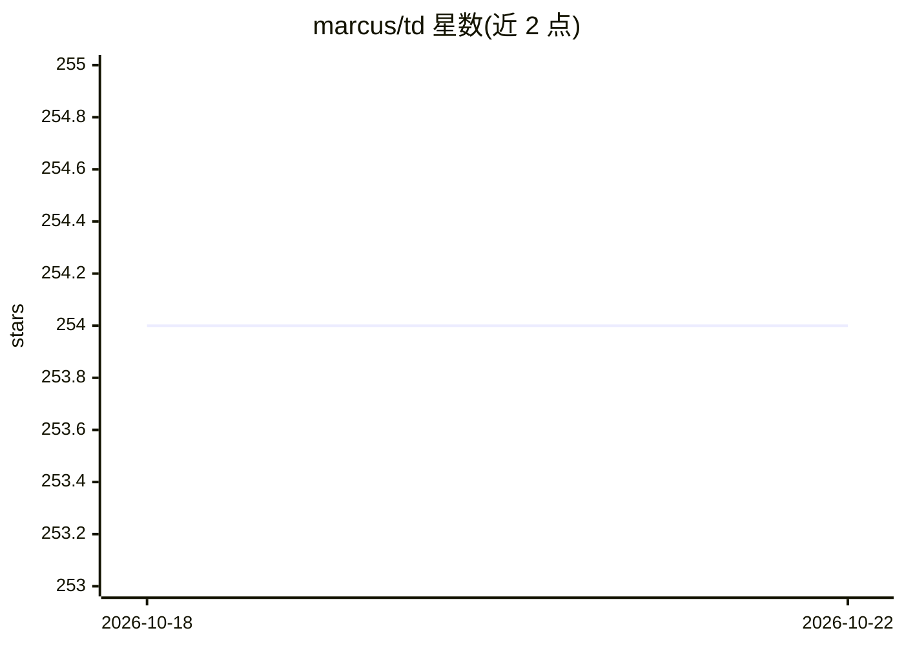

# marcus/td

⭐ 254 · Go · MIT · 推送 2026-10-20 · [GitHub](https://github.com/marcus/td) · 个人维护

**AI 编码会话间的任务追踪 CLI，充当外部记忆**

Go 编写的轻量 CLI，为 AI 编码会话（Claude Code、Cursor、Codex、Copilot 等）提供任务与状态的持久化记录：结构化交接（已完成/剩余/决策/不确定）、会话审计与评审工作流、TDQ 查询语言、看板、依赖图与关键路径、epic 树、文件 SHA 追踪，数据存于本地 SQLite 并集成 git 快照。提供 Homebrew、预编译二进制（macOS/Linux amd64/arm64）与 go install 三种安装方式，可作为 Claude Code/Codex skill 使用。

## 筛选速览

| 维度 | 判定 | 备注 |
|---|---|---|
| AI 角色 | `ai-ecosystem` | LLM/agent 周边工具 |
| 许可风险 | `permissive` | MIT |
| 部署形态 | `library` | 以包/库形式分发 |
| 模型依赖 | — | README 未给出锁定关系 |
| 硬件要求 | — | 无带数字的原话,不猜 |
| 安装摩擦 | `medium` | 含编译或系统依赖之一 |
| 成熟度 | — | 结构信号不足 |

## 能力要点

- 结构化交接：done/remaining/decision/uncertain 四类状态供下一会话续接
- TDQ 查询语言支持字段过滤、布尔运算符与函数
- 依赖图与 critical-path 拓扑排序找最优工作顺序
- 所有命令支持 --json 输出，便于脚本化与 agent 调用

## 适用场景

- AI agent 会话结束后让新会话从准确状态继续
- 对 agent 完成的工作做记录与评审追踪
- 跨多个相关 issue 组织工作会话并记录共享决策

## 场景标签

 · 领域:开发者工具/任务管理

## 证据(README 行号)

> L7: A minimalist CLI for tracking tasks across AI coding sessions. When your context window ends, your agent's memory en
> L11: `td` is a lightweight CLI for tracking tasks across AI coding sessions. It provides structured handoffs (done/remai
> L101: ## Claude Code / OpenAI Codex Skill

## 星数曲线

2026-10-18 254 → 2026-10-22 254（+0）

---
*卡片 v1 · prompt 1.4 · 生成 2026-10-22 · 置信度 high · 依据 README sha `5b1f9fd6be20` · [字段定义](../../DATASET.md)*
