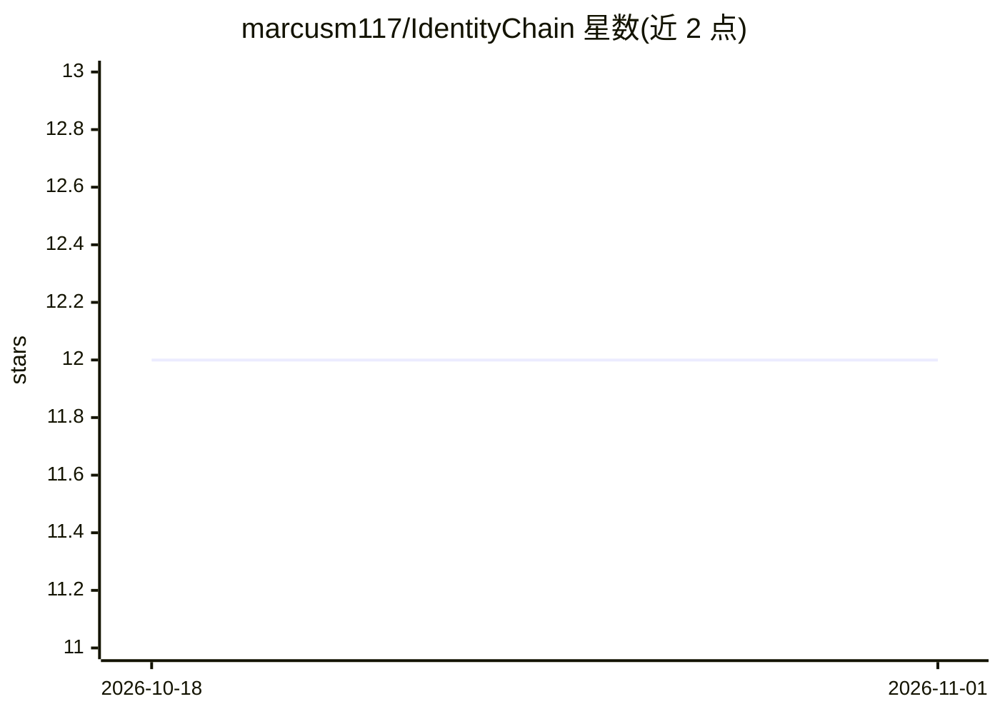

# marcusm117/IdentityChain

⭐ 12 · Python · Apache-2.0 · 推送 2025-11-24 · [GitHub](https://github.com/marcusm117/IdentityChain) · [官网](https://arxiv.org/abs/2310.14053) · 个人维护

**评测 Code LLM 跨任务自洽性的框架（ICLR 2024）**

ICLR 2024 论文 Beyond Accuracy 的官方实现，用 Python 编写并发布于 PyPI。框架评测代码大模型的自然语言转代码（代码生成）准确率、代码转自然语言（代码摘要）准确率，以及两个任务之间的自洽性（SC/SSC），并提供逐步骤、逐样本的细粒度分析（TOM/BLEU/CodeBLEU 轨迹）以定位自洽性违反的具体位置。用户需准备评测数据集、双向 prompt 与生成函数；提供 OpenAI、Google、HuggingFace 开源模型的示例脚本，结果经 analyze_results.py 生成 xlsx 报告。

## 筛选速览

| 维度 | 判定 | 备注 |
|---|---|---|
| AI 角色 | `ai-ecosystem` | LLM/agent 周边工具 |
| 许可风险 | `permissive` | Apache-2.0 |
| 部署形态 | `library` | 以包/库形式分发 |
| 模型依赖 | — | README 未给出锁定关系 |
| 硬件要求 | — | 无带数字的原话,不猜 |
| 安装摩擦 | `low` | 无编译、无系统依赖或容器化 |
| 成熟度 | — | 结构信号不足 |

## 能力要点

- 评测 NL-to-PL、PL-to-NL 双向准确率及跨任务自洽性（SC/SSC）
- 逐步骤 TOM/BLEU/CodeBLEU 轨迹定位自洽性违反的样本与步骤
- 提供 OpenAI/Google/HuggingFace 模型评测示例脚本
- 提供批处理运行脚本与结果分析、浏览工具

## 适用场景

- 我想评测自己微调的 Code LLM 在生成与摘要任务间是否自洽
- 定位模型在哪一步哪一样本出现自洽性违反
- 对比 CodeLlama/StarCoder/DeepSeekCoder 等模型的自洽性得分

## 场景标签

`模型评测` · 领域:评测与运维

## 证据(README 行号)

> L5: The IdentityChain Framework for Code Large Language Models (Code LLMs) Evaluation. Official implementation of the IC
> L7: The IdentityChain Framework evaluates the NL-to-PL (Code Generation) Accuracy, PL-to-NL (Code Summurization) Accurac

## 星数曲线

2026-10-18 12 → 2026-11-01 12（+0）

---
*卡片 v1 · prompt 1.4 · 生成 2026-11-01 · 置信度 high · 依据 README sha `fc0dfc6ca327` · [字段定义](../../DATASET.md)*
