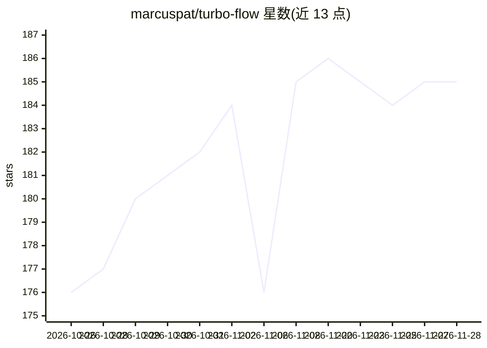

# marcuspat/turbo-flow

⭐ 185 · Shell · MIT · 推送 2026-11-26 · [GitHub](https://github.com/marcuspat/turbo-flow) · [官网](https://www.turboflow.online/) · 组织维护

**给 AI 写代码的仓库加跨模型审查门禁的治理工具包**

turbo-flow v5 起定位为「规则层」：一个放入任意仓库即可用的 rig-lite 治理套件，仅依赖 bash、不自带 agent。核心机制是 gate.sh 跨模型审查门禁——先跑确定性检查，再要求与构建者不同模型家族的 reviewer 返回 APPROVED/REVISE，fail-closed、永不自动合并，裁决写入 JSONL 日志并钉在所审查的 SHA 上；配套 branch protection 设置、git 版本化记忆、加密密钥存储、worktree 隔离、token 消耗面板与 tmux 多窗口工作环境。v1–4 曾是围绕 Claude Code 的 agentic 开发环境，v5.2 起移除了编排栈。

## 筛选速览

| 维度 | 判定 | 备注 |
|---|---|---|
| AI 角色 | `ai-ecosystem` | LLM/agent 周边工具 |
| 许可风险 | `permissive` | MIT |
| 部署形态 | `library` | 以包/库形式分发 |
| 模型依赖 | — | README 未给出锁定关系 |
| 硬件要求 | — | 无带数字的原话,不猜 |
| 安装摩擦 | `low` | 无编译、无系统依赖或容器化 |
| 成熟度 | — | 结构信号不足 |

## 能力要点

- 跨模型审查门禁：reviewer 必须来自与 builder 不同的模型家族，自动拒绝同家族审查
- fail-closed 设计：门禁从不合并代码，裁决钉在所审查的具体 commit SHA 上，轮次上限默认 3
- git-versioned 记忆模式（index/decisions/gotchas）与 JSONL 裁决日志
- tf 单命令入口：gate/test/status/tokens/digest/wt/secrets 等子命令

## 适用场景

- 给团队中 AI agent 产出的 PR 加强制跨模型审查门禁
- 管理多个编码 agent（builder/reviewer 分工）的并行开发流程
- 统计多个 AI 编码 CLI 的 token 消耗与仓库健康度

## 场景标签

`代码审查` · 领域:编码与开发

## 证据(README 行号)

> L10: > The rules layer, packaged as a kit you drop into any repo: `rig-lite/` — a portable governance kit. It ships no h
> L24: Turbo Flow bundles no agent and no orchestrator. It names harnesses by **role**, and works with any tool that reads
> L57: |`gate.sh`|a cross-model review gate — deterministic checks first (they're free), then a reviewer from a **differen

## 星数曲线

2026-10-26 176 → 2026-11-28 185（+9）

---
*卡片 v1 · prompt 1.4 · 生成 2026-11-27 · 置信度 mid · 依据 README sha `4cdaa1556c2f` · [字段定义](../../DATASET.md)*
