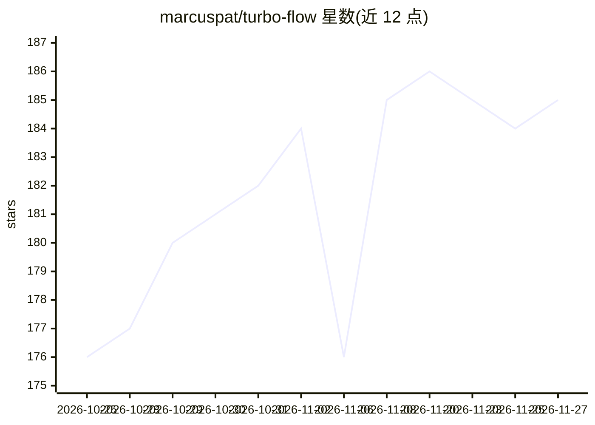

# marcuspat/turbo-flow

⭐ 185 · Shell · MIT · 推送 2026-11-26 · [GitHub](https://github.com/marcuspat/turbo-flow) · [官网](https://www.turboflow.online/) · 个人维护

**给 AI 写的代码加跨模型审查门禁与治理规则的开发工具包**

一个打包为可移植工具包（rig-lite）的 AI 代码治理层：先运行确定性检查，再由不同模型家族的 reviewer 给出 fail-closed 的 APPROVED/REVISE 判定，判定写入本地 JSONL 日志并可发布为 GitHub PR 评论与必需状态检查。附带 git 版本化的 memory 模式、加密密钥管理、worktree 隔离、token 用量面板与 9 个后台自动化任务。仅依赖 bash，不自带 harness，适配任何读取 AGENTS.md 并能运行 bash 的编码代理；v5.2 起移除了编排栈，v1–4 曾是围绕 Claude Code 的代理开发环境。

## 筛选速览

| 维度 | 判定 | 备注 |
|---|---|---|
| AI 角色 | `ai-ecosystem` | LLM/agent 周边工具 |
| 许可风险 | `permissive` | MIT |
| 部署形态 | `library` | 以包/库形式分发 |
| 模型依赖 | locked-api |  |
| 硬件要求 | — | 无带数字的原话,不猜 |
| 安装摩擦 | `low` | 无编译、无系统依赖或容器化 |
| 成熟度 | `idea` | |

## 能力要点

- gate.sh 跨模型审查门禁：拒绝同家族审查、判定钉住具体 SHA、轮次上限后交人工
- protect.sh 将门禁判定设为 GitHub 分支保护的必需状态检查
- tf 单命令入口：gate/test/status/tokens/digest 等子命令
- git 版本化 memory 模式与加密密钥管理（Keychain/libsecret/age）

## 适用场景

- AI 代理生成的 PR 在合并前必须通过跨模型审查
- 团队用 JSONL 日志与 digest 跟踪代理产出与仓库健康
- 多代理并行开发时用 worktree 隔离各写入者

## 场景标签

`代码审查` · 领域:编码与开发

## 证据(README 行号)

> L10: > The rules layer, packaged as a kit you drop into any repo: `rig-lite/` — a portable governance kit. It ships no h
> L20: Turbo Flow bundles no agent and no orchestrator. It names harnesses by **role**, and works with any tool that reads

## 星数曲线

2026-10-25 176 → 2026-11-27 185（+9）

---
*卡片 v1 · prompt 1.4 · 生成 2026-11-26 · 置信度 mid · 依据 README sha `ae7d37eeb571` · [字段定义](../../DATASET.md)*
