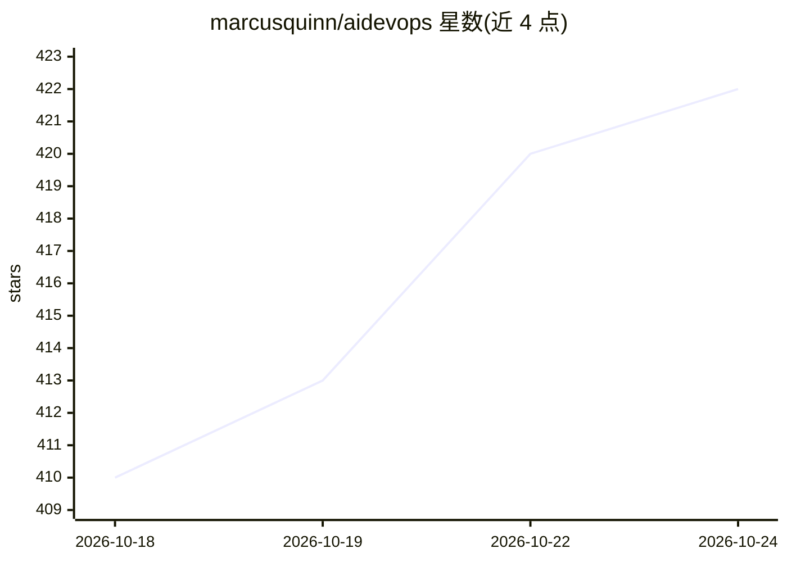

# marcusquinn/aidevops

⭐ 421 · Shell · MIT · 推送 2026-10-24 · [GitHub](https://github.com/marcusquinn/aidevops) · [官网](https://www.aidevops.sh) · 个人维护

**OpenCode 插件式 AI DevOps 框架：agent 团队自动交付软件工作**

aidevops.sh 是一个 OpenCode 插件与 AI DevOps 框架，面向开发者、运维与个人项目，将意图驱动的任务推进到验证过的交付结果。它组织 17 个主 agent、2,250+ 子 agent/skill、2,100+ 辅助脚本与 110+ 斜杠命令，提供模型路由分层、Pulse 无人值守调度、安全 Git 工作流（linked worktree、证据门禁、受保护合并）、密钥管理与审计。交互运行时以 OpenCode 为主，Claude Code 与 Codex CLI 亦受支持。安装经 Homebrew 或 npm 全局部署，并配置 OpenCode 与可选 Tabby 终端。

## 筛选速览

| 维度 | 判定 | 备注 |
|---|---|---|
| AI 角色 | `ai-ecosystem` | LLM/agent 周边工具 |
| 许可风险 | `permissive` | MIT |
| 部署形态 | `library` | 以包/库形式分发 |
| 模型依赖 | — | README 未给出锁定关系 |
| 硬件要求 | — | 无带数字的原话,不猜 |
| 安装摩擦 | `low` | 无编译、无系统依赖或容器化 |
| 成熟度 | — | 结构信号不足 |

## 能力要点

- 17 个主 agent、2,250+ 子 agent、110+ 斜杠命令的可寻址源码清单
- /full-loop 全周期交付：实现→验证→PR→受权限控制的合并/发布
- Pulse 每 2 分钟调度无头 worker 处理标记 auto-dispatch 的 issue
- provider 中立的 simple/standard/thinking 工作负载路由分层

## 适用场景

- 让 AI agent 团队在仓库内完成从实现到 PR 的开发任务
- 无人值守定时例程与自主运维调度
- 在多个模型 provider 与账号池之间做路由与限额轮换

## 场景标签

`编码 Agent` `工作流自动化` · 领域:效率与自动化

## 证据(README 行号)

> L5: **aidevops.sh** is an OpenCode
> L155: - **Recommended runtime:** OpenCode; Claude Code and Codex CLI are supported interactive runtimes

## 星数曲线

2026-10-18 410 → 2026-10-24 422（+12）

---
*卡片 v1 · prompt 1.4 · 生成 2026-10-21 · 置信度 high · 依据 README sha `71f563995663` · [字段定义](../../DATASET.md)*
