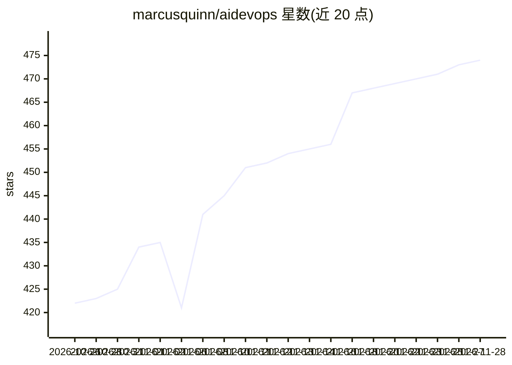

# marcusquinn/aidevops

⭐ 474 · Shell · MIT · 推送 2026-11-27 · [GitHub](https://github.com/marcusquinn/aidevops) · [官网](https://www.aidevops.sh) · 个人维护

**面向开发者的 OpenCode AI DevOps 插件与 agent 自动化框架**

aidevops.sh 是一个 OpenCode 插件形态的 AI DevOps 框架，将意图推进到经过验证的交付结果。它包含 17 个主 agent、2,250+ 可寻址 subagent、2,218 个辅助脚本和 111 个斜杠命令，覆盖软件交付、自主运维、知识留存、安全门控与 Git 工作流；按 simple/standard/thinking 三档路由模型能力，Pulse 调度器每 2 分钟派发 headless worker 处理标记仓库的问题。安装方式为 Homebrew 或全局 npm 包，配置时部署 agent 并安装 OpenCode 与 Tabby。

## 筛选速览

| 维度 | 判定 | 备注 |
|---|---|---|
| AI 角色 | `ai-ecosystem` | LLM/agent 周边工具 |
| 许可风险 | `permissive` | MIT |
| 部署形态 | `library` | 以包/库形式分发 |
| 模型依赖 | — | README 未给出锁定关系 |
| 硬件要求 | — | 无带数字的原话,不猜 |
| 安装摩擦 | `low` | 无编译、无系统依赖或容器化 |
| 成熟度 | — | 结构信号不足 |

## 能力要点

- 17 个主 agent 与 2,250+ 可寻址 subagent/skill/workflow 清单
- Pulse 每 2 分钟调度 headless worker，按 repos.json 中 pulse 标记派发
- provider 中立的 simple/standard/thinking 模型路由分档
- Homebrew 与 npm 全局安装，内置 status/doctor 健康检查

## 适用场景

- 用 AI agent 从需求描述一路推进到实现、验证与 PR 合并
- 对注册仓库开启无人值守的自动化问题分派与例行任务
- 在 AI 开发会话中按任务复杂度路由不同模型档位

## 场景标签

`工作流自动化` `代码审查` `Agent 框架` · 领域:Agent 开发

## 证据(README 行号)

> L5: **aidevops.sh** is an OpenCode
> L6: plugin and AI DevOps framework for carrying work from intent to a verified
> L167: - **Recommended runtime:** OpenCode; Claude Code and Codex CLI are supported interactive runtimes

## 星数曲线

2026-10-26 422 → 2026-11-28 474（+52）

---
*卡片 v1 · prompt 1.4 · 生成 2026-11-28 · 置信度 high · 依据 README sha `71b2d5ebbdc3` · [字段定义](../../DATASET.md)*
