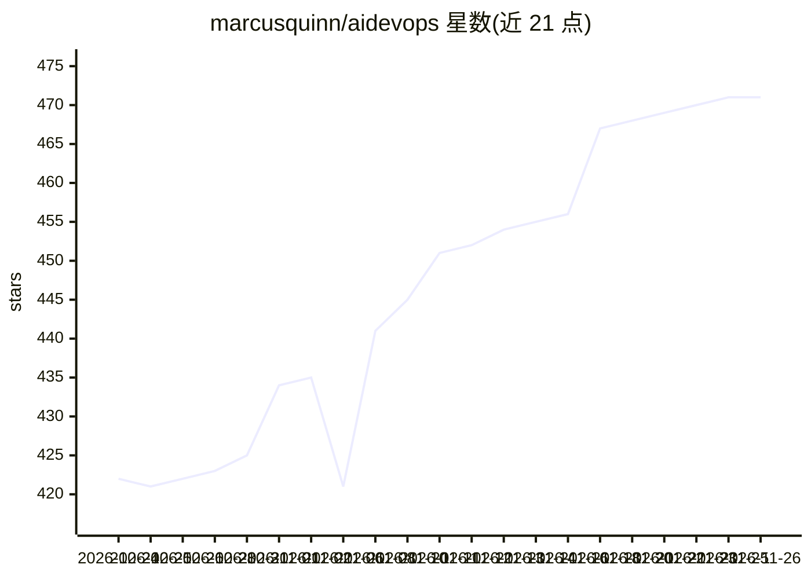

# marcusquinn/aidevops

⭐ 471 · Shell · MIT · 推送 2026-11-25 · [GitHub](https://github.com/marcusquinn/aidevops) · [官网](https://www.aidevops.sh) · 个人维护

**面向开发者的 OpenCode AI DevOps agent 框架与插件**

aidevops.sh 是 OpenCode 插件与 DevOps 框架，以 17 个主 agent、2,250+ 子 agent、2,218 个辅助脚本和 111 个斜杠命令组织，覆盖从意图到验证交付的流程：仓库级任务/计划/证据持久化、模型路由分层、Git 安全工作流、Pulse 定时调度无人值守 worker、密钥隔离与操作门控。通过 Homebrew 或 npm 全局安装，部署到 ~/.aidevops 并配置 OpenCode；核心生命周期为理解→隔离→实现→验证→PR→合并发布。

## 筛选速览

| 维度 | 判定 | 备注 |
|---|---|---|
| AI 角色 | `ai-ecosystem` | LLM/agent 周边工具 |
| 许可风险 | `permissive` | MIT |
| 部署形态 | `library` | 以包/库形式分发 |
| 模型依赖 | — | README 未给出锁定关系 |
| 硬件要求 | — | 无带数字的原话,不猜 |
| 安装摩擦 | `low` | 无编译、无系统依赖或容器化 |
| 成熟度 | — | 结构信号不足 |

## 能力要点

- 17 个主 agent 与 2,250+ 可寻址子 agent/skill/工作流的源码清单，可脚本审计计数
- Pulse 每 2 分钟调度 headless worker，按 repos.json 中 pulse 标记分发 auto-dispatch 任务
- provider-neutral 的 simple/standard/thinking 三档模型路由
- 密钥不入聊天与 Git，提供 Vault、审计追踪与 prompt-injection 防御

## 适用场景

- 让 AI agent 在仓库内自主完成从 issue 到 PR 的完整交付流程
- 为团队统一 AI 编码协作约定与安全门控
- 定时无人值守运行仓库维护与例行任务
- 多模型提供商账号池轮换应对限流

## 场景标签

`Agent 框架` `代码审查` `模型网关` · 领域:Agent 开发

## 证据(README 行号)

> L5: **aidevops.sh** is an OpenCode
> L6: plugin and AI DevOps framework for carrying work from intent to a verified
> L167: - **Recommended runtime:** OpenCode; Claude Code and Codex CLI are supported interactive runtimes

## 星数曲线

2026-10-24 422 → 2026-11-26 471（+49）

---
*卡片 v1 · prompt 1.4 · 生成 2026-11-26 · 置信度 high · 依据 README sha `103b1324a9e0` · [字段定义](../../DATASET.md)*
