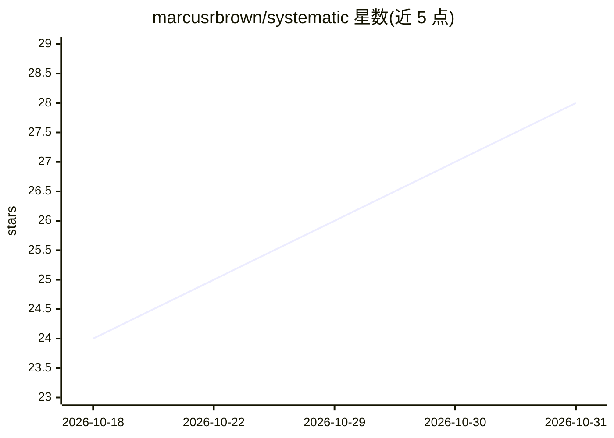

# marcusrbrown/systematic

⭐ 28 · TypeScript · MIT · 推送 2026-10-30 · [GitHub](https://github.com/marcusrbrown/systematic) · [官网](https://fro.bot/systematic) · 个人维护

**为 OpenCode/Pi/Claude Code 提供复合工程循环的技能与 Agent 插件**

面向 AI 编程工具的插件：将头脑风暴、计划、执行、评审四阶段封装为结构化技能，引导 AI 完成需求探索、实现规划、编码与代码评审，并沉淀学习记录。内置 33 个技能与 37 个专项 Agent（架构、安全、性能、设计、评审）。同一套内容支持 OpenCode、Pi、Claude Code 三种 harness，各提供原生安装路径；另可通过 npx skills 仅导出技能内容给 Cursor、Copilot 等其他 harness（不含工具注册）。MIT 许可。

## 筛选速览

| 维度 | 判定 | 备注 |
|---|---|---|
| AI 角色 | `ai-ecosystem` | LLM/agent 周边工具 |
| 许可风险 | `permissive` | MIT |
| 部署形态 | `library` | 以包/库形式分发 |
| 模型依赖 | — | README 未给出锁定关系 |
| 硬件要求 | — | 无带数字的原话,不猜 |
| 安装摩擦 | `low` | 无编译、无系统依赖或容器化 |
| 成熟度 | — | 结构信号不足 |

## 能力要点

- brainstorm/plan/work/review 四阶段复合工程循环
- 内置 33 个技能与 37 个专项 Agent（架构/安全/性能/设计/评审）
- 一套内容支持 OpenCode、Pi、Claude Code 三种 harness
- npx skills 可向任意 harness 导出技能内容（仅内容，无工具注册）

## 适用场景

- 让 Claude Code / OpenCode / Pi 按 /ce: 命令执行完整工程流程
- 把团队工程规范编码进 AI 编程环境形成可重复工作流
- 为 Cursor/Copilot 等工具复用技能内容

## 场景标签

`编码 Agent` `代码审查` · 领域:编码与开发

## 证据(README 行号)

> L18: Systematic is a compound-engineering loop: brainstorm, plan, work, review — each phase a structured skill that guid
> L20: The workflow runs on three harnesses from one source: OpenCode, Pi, and Claude Code. Each gets a native install pat

## 星数曲线

2026-10-18 24 → 2026-10-31 28（+4）

---
*卡片 v1 · prompt 1.4 · 生成 2026-10-27 · 置信度 high · 依据 README sha `aca10397555e` · [字段定义](../../DATASET.md)*
