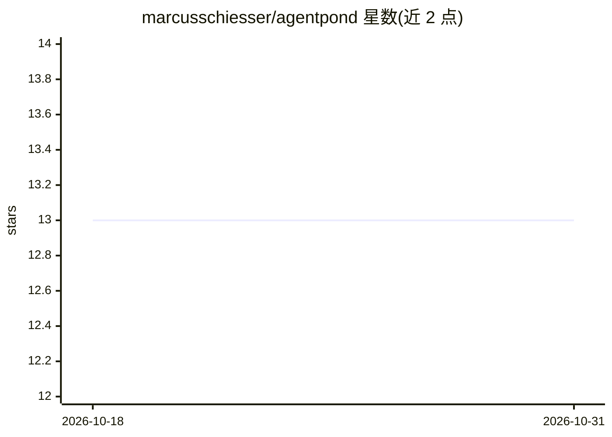

# marcusschiesser/agentpond

⭐ 13 · TypeScript · MIT · 推送 2026-10-12 · [GitHub](https://github.com/marcusschiesser/agentpond) · 个人维护

**AI agent 轨迹的私有存储后端与本地分析 CLI**

轻量级 trace 后端加 CLI：原始 agent 轨迹存入用户自控的对象存储（Files SDK 兼容的 S3、Azure Blob、GCS、R2、MinIO，及 Firebase/Supabase/Vercel 一键启动），再增量同步到本地 DuckDB 缓存做分析与任意 SQL 查询。支持 OpenTelemetry 直接导出与 Langfuse 兼容、OTLP HTTP 摄取适配器，人类标注以 scores 表示。明确不提供 Web UI、托管存储与常驻数据库基础设施。面向需要掌控 trace 数据的开发者。

## 筛选速览

| 维度 | 判定 | 备注 |
|---|---|---|
| AI 角色 | `ai-ecosystem` | LLM/agent 周边工具 |
| 许可风险 | `permissive` | MIT |
| 部署形态 | `library` | 以包/库形式分发 |
| 模型依赖 | — | README 未给出锁定关系 |
| 硬件要求 | — | 无带数字的原话,不猜 |
| 安装摩擦 | `low` | 无编译、无系统依赖或容器化 |
| 成熟度 | — | 结构信号不足 |

## 能力要点

- 轨迹存于用户自控对象存储，DuckDB 为可重建的分析缓存
- 支持 OpenTelemetry 直接导出与 Langfuse 兼容/OTLP HTTP 摄取
- 本地 projections 覆盖 traces/observations/sessions/scores，支持任意 SQL
- npx init 由编码 agent 自动完成插桩与存储设置

## 适用场景

- 把 coding agent 的运行轨迹留在自己的基础设施里而非第三方平台
- 用本地 DuckDB 与 SQL 对 agent 轨迹做分析
- 配合 Langfuse/OTLP 协议导出链路接入现有 trace

## 场景标签

`LLM 可观测性` · 领域:评测与运维

## 证据(README 行号)

> L11: AgentPond is a lightweight trace backend and CLI for AI applications. It keeps raw traces in object storage you con
> L17: Object storage is the durable source of truth. The local DuckDB database is a rebuildable analytical cache, so prod

## 星数曲线

2026-10-18 13 → 2026-10-31 13（+0）

---
*卡片 v1 · prompt 1.4 · 生成 2026-10-31 · 置信度 high · 依据 README sha `3e806f8c620f` · [字段定义](../../DATASET.md)*
