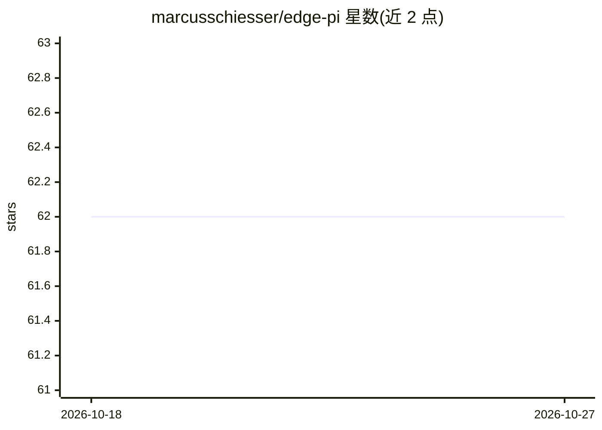

# marcusschiesser/edge-pi

⭐ 62 · TypeScript · MIT · 推送 2026-02-23 · [GitHub](https://github.com/marcusschiesser/edge-pi) · [官网](https://edge-pi-beta.vercel.app/) · 个人维护

**基于 Vercel AI SDK 的轻量编码 agent 库与 CLI**

TypeScript 编码 agent 库，提供工具调用、会话管理、上下文压缩等核心原语，用于构建 AI 编码助手；支持多 LLM provider，基于 Vercel AI SDK 实现。附带 `epi` CLI 作为概念验证，具备多 provider 支持与 skills 功能。代码基于 Mario Zechner 的 pi 编码 agent。自述定位为 Claude Agent SDK 的替代方案，但兼容任意 LLM provider。

## 筛选速览

| 维度 | 判定 | 备注 |
|---|---|---|
| AI 角色 | `ai-ecosystem` | LLM/agent 周边工具 |
| 许可风险 | `permissive` | MIT |
| 部署形态 | `library` | 以包/库形式分发 |
| 模型依赖 | — | README 未给出锁定关系 |
| 硬件要求 | — | 无带数字的原话,不猜 |
| 安装摩擦 | `low` | 无编译、无系统依赖或容器化 |
| 成熟度 | `idea` | |

## 能力要点

- 提供工具支持、会话管理、上下文压缩的 agent 核心原语
- 多 LLM provider 支持，基于 Vercel AI SDK
- 附带 epi CLI，含多 provider 支持与 skills

## 适用场景

- 构建自定义 AI 编码助手或编码 agent
- 通过 CLI 快速获得可扩展的编码 agent 起点

## 场景标签

`Agent 框架` `编码 Agent` · 领域:Agent 开发

## 证据(README 行号)

> L3: Edge-Pi is a lightweight, Vercel AI SDK based coding agent library.
> L7: The `epi` CLI is a full-featured coding agent that features: multi-provider support, skills. It is a proof of concep

## 星数曲线

2026-10-18 62 → 2026-10-27 62（+0）

---
*卡片 v1 · prompt 1.4 · 生成 2026-10-24 · 置信度 high · 依据 README sha `911b2d4e2fdf` · [字段定义](../../DATASET.md)*
