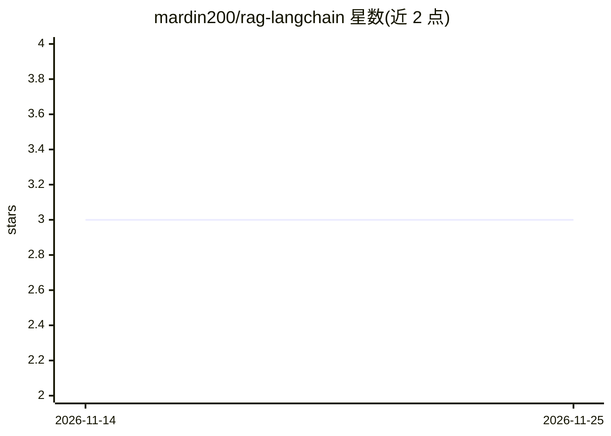

# mardin200/rag-langchain

⭐ 3 · HTML · 推送 2026-10-25 · [GitHub](https://github.com/mardin200/rag-langchain) · 个人维护

**基于文档的 RAG 问答机器人，用 LangChain/FastAPI/Chroma 构建**

以 LangChain 为核心的文档 RAG 应用：用户上传 PDF/Word/Txt/Markdown 文档，系统切分（800 字符块、120 重叠）、嵌入并索引到 ChromaDB，通过 Web 界面提供语义检索与文档问答，回答附带来源文件名与页码，支持会话上下文追问。后端 FastAPI，提供 REST API 与 OpenAPI 文档页，数据通过 bind mount 持久化。运行需配置模型提供方的 API key 与基础 URL，支持 OpenAI 兼容端点；部署方式为 Docker Compose 或本地 Python 环境。评测功能尚未实现。

## 筛选速览

| 维度 | 判定 | 备注 |
|---|---|---|
| AI 角色 | `ai-native` | 本体是模型或模型工具 |
| 许可风险 | `none` | — |
| 部署形态 | `self-host` | docker 或自建部署 |
| 模型依赖 | — | README 未给出锁定关系 |
| 硬件要求 | — | 无带数字的原话,不猜 |
| 安装摩擦 | `low` | 无编译、无系统依赖或容器化 |
| 成熟度 | — | 结构信号不足 |

## 能力要点

- 文档上传、分块索引到 ChromaDB，支持 PDF/DOCX/TXT/MD
- 语义检索与基于文档内容的聊天回答，附来源文件名与页码
- 提供 REST API（上传/删除/检索/聊天）与 /docs 交互文档
- Docker Compose 部署，uploads 与 chroma 目录持久化

## 适用场景

- 搭建自己的文档知识库问答系统
- 上传技术规范等文档后用自然语言提问并查看出处
- 通过 API 将文档问答能力接入其他系统

## 场景标签

`RAG` `文档问答` · 领域:知识与检索

## 证据(README 行号)

> L3: A document-based Retrieval-Augmented Generation (RAG) application built with LangChain, FastAPI, and ChromaDB.
> L5: The application allows users to upload documents, search their contents semantically, and ask questions through a ch
> L12: - **Document-Based Chat:** Ask questions about your documents and receive answers grounded in retrieved content.

## 星数曲线

2026-11-14 3 → 2026-11-25 3（+0）

---
*卡片 v1 · prompt 1.4 · 生成 2026-11-21 · 置信度 high · 依据 README sha `9aadb02c46fe` · [字段定义](../../DATASET.md)*
