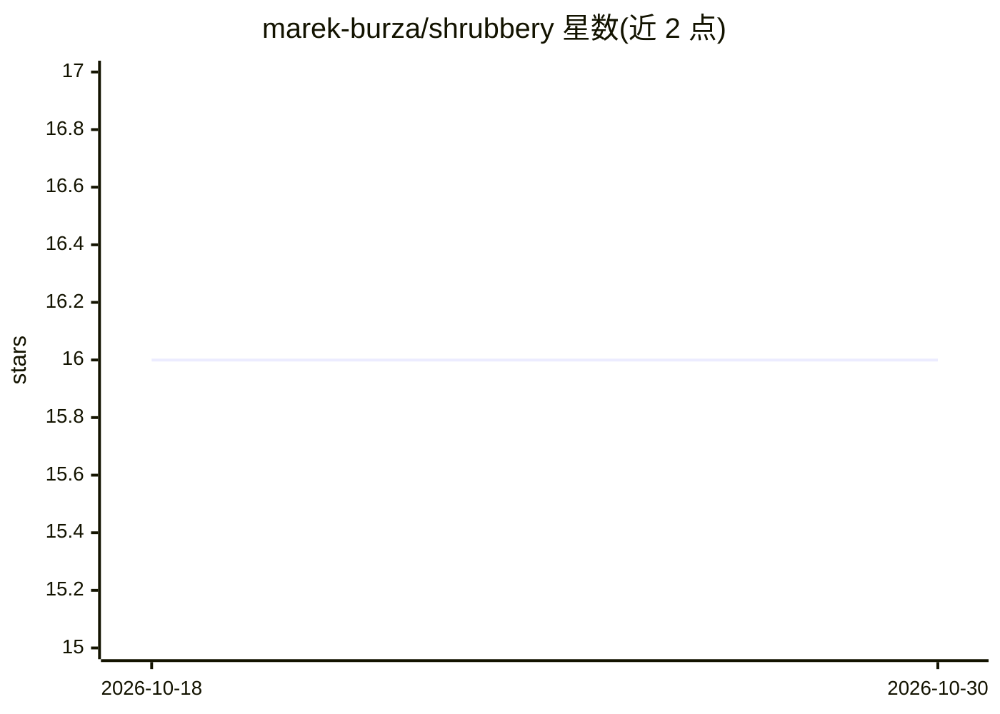

# marek-burza/shrubbery

⭐ 16 · Python · GPL-3.0 · 推送 2026-10-28 · [GitHub](https://github.com/marek-burza/shrubbery) · 个人维护

**个人实验仓库：用机器学习模型参与 Numerai 量化竞赛并提交预测**

作者用于学习金融市场与 Numerai 的实验性代码库。核心是 Numerai 流水线（src/shrubbery/numerai/）：模型脚本定义 scikit-learn 接口的 ESTIMATOR，由 NumeraiRunner 统一负责数据下载、训练（--retrain）、artifact 持久化（cloudpickle 按值序列化）与锦标赛预测上传；支持 cron 定时执行、Docker 容器运行、GPU 加速（cuML/XGBoost GPU/PyTorch）。附带工具：numerai-scores 拉取赛事成绩、shrubbery-notes 加密笔记存储、financial-semantics 金融词汇与标识符查询。含市场中性化、VaR/CAPM 等独立金融实验脚本。

## 筛选速览

| 维度 | 判定 | 备注 |
|---|---|---|
| AI 角色 | `ai-native` | 本体是模型或模型工具 |
| 许可风险 | `viral` | GPL-3.0 |
| 部署形态 | `None` |  |
| 模型依赖 | — | README 未给出锁定关系 |
| 硬件要求 | — | 无带数字的原话,不猜 |
| 安装摩擦 | `medium` | 含编译或系统依赖之一 |
| 成熟度 | — | 结构信号不足 |

## 能力要点

- ESTIMATOR 估计器接口 + 统一训练/推理/提交 harness 的模型管理流水线
- era 感知处理与 cloudpickle 按值持久化（artifact 自带代码）
- GPU-first：cuML、XGBoost GPU、PyTorch 加速
- numerai-scores / shrubbery-notes（PyNaCl 加密）/ financial-semantics（FIBO、ISO 标准等）配套 CLI 工具

## 适用场景

- 训练并定时提交 Numerai 锦标赛预测模型
- 搭建自己的 Numerai 模型训练与提交流水线
- 进行市场中性化、VaR/CAPM 等金融实验分析

## 场景标签

`金融量化` · 领域:学习与行业

## 证据(README 行号)

> L3: Shrubbery is a repo where I experiment with learning about financial markets and Numerai and how to apply machine le
> L58: **Entry point**: `main.py` - `numerai-run --model <model>` hands the model name to `NumeraiRunner`, which derives b
> L81: - **The estimator owns the prediction range.** Numerai validates an upload as: exactly a `pd.DataFrame`, non-empty,

## 星数曲线

2026-10-18 16 → 2026-10-30 16（+0）

---
*卡片 v1 · prompt 1.4 · 生成 2026-10-30 · 置信度 high · 依据 README sha `3b2e0c2d8117` · [字段定义](../../DATASET.md)*
