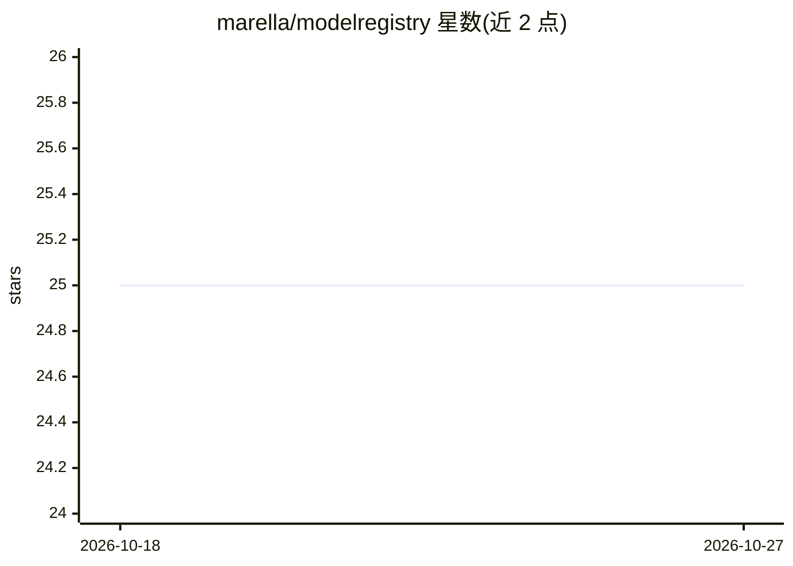

# marella/modelregistry

⭐ 25 · HTML · MIT · 推送 2026-10-26 · [GitHub](https://github.com/marella/modelregistry) · [官网](https://modelregistry.io) · 个人维护

**开源 AI 模型的去中心化分发注册目录**

README 仅含项目名、一句使命陈述（去中心化开源 AI 模型的分发）与指向 modelregistry.io 的链接，未提供安装方式、运行机制或功能细节。从定位看是面向开源模型分发的注册/目录类基础设施，具体能力需访问其站点确认。本条目信息量极少，仅可确认其存在与定位声明。

## 筛选速览

| 维度 | 判定 | 备注 |
|---|---|---|
| AI 角色 | `ai-knowledge` | 知识聚合/清单类 |
| 许可风险 | `permissive` | MIT |
| 部署形态 | `None` |  |
| 模型依赖 | — | README 未给出锁定关系 |
| 硬件要求 | — | 无带数字的原话,不猜 |
| 安装摩擦 | `low` | 无编译、无系统依赖或容器化 |
| 成熟度 | — | 结构信号不足 |

## 能力要点

- 使命陈述为去中心化开源 AI 模型的分发
- 提供 modelregistry.io 站点入口

## 适用场景

- 查找通过该注册目录分发的开源模型（需访问站点确认）

## 场景标签

 · 领域:AI 模型分发/基础设施

## 证据(README 行号)

> L3: Decentralizing distribution of open-source AI models.
> L5: See modelregistry.io

## 星数曲线

2026-10-18 25 → 2026-10-27 25（+0）

---
*卡片 v1 · prompt 1.4 · 生成 2026-10-27 · 置信度 low · 依据 README sha `59717196f5a2` · [字段定义](../../DATASET.md)*
