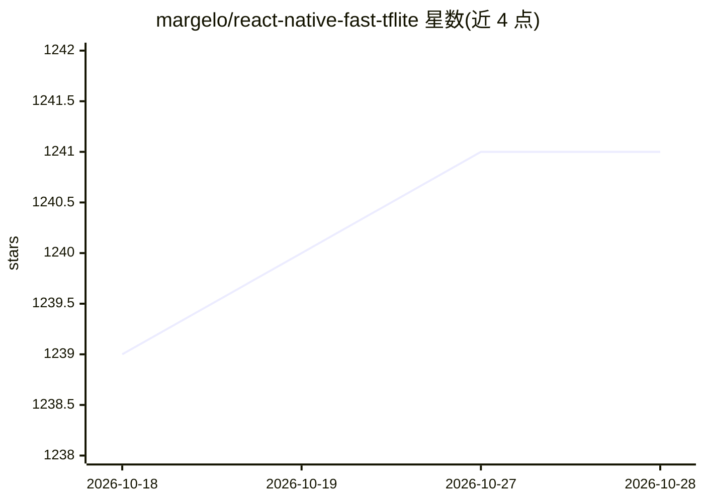

# margelo/react-native-fast-tflite

⭐ 1,241 · TypeScript · MIT · 推送 2026-09-11 · [GitHub](https://github.com/margelo/react-native-fast-tflite) · [官网](https://mrousavy.com) · 组织维护

**React Native 的 TensorFlow Lite 高性能运行库，支持 GPU 加速**

基于 Nitro Modules 构建的 React Native 库，封装 TensorFlow Lite 低层 C/C++ 核心 API，供移动 App 加载 .tflite 模型并以 ArrayBuffer 零拷贝方式运行推理；支持运行时热切换模型，可选 GPU 加速代理（iOS CoreML/Metal、Android GPU/NNAPI），并提供 VisionCamera 帧处理器集成用于实时相机推理。面向需要端侧 ML 的 React Native/Expo 开发者。限制：需自行解释原始张量字节（模型输入输出形状需用 Netron 查看），部分模型操作不受 CoreML 代理支持。

## 筛选速览

| 维度 | 判定 | 备注 |
|---|---|---|
| AI 角色 | `ai-ecosystem` | LLM/agent 周边工具 |
| 许可风险 | `permissive` | MIT |
| 部署形态 | `library` | 以包/库形式分发 |
| 模型依赖 | — | README 未给出锁定关系 |
| 硬件要求 | — | 无带数字的原话,不猜 |
| 安装摩擦 | `low` | 无编译、无系统依赖或容器化 |
| 成熟度 | — | 结构信号不足 |

## 能力要点

- 零拷贝 ArrayBuffer 输入输出，直连 TFLite C/C++ 核心 API
- GPU 加速代理：CoreML/Metal（iOS）与 Android GPU/NNAPI
- 支持运行时热替换 .tflite 模型而无需重新构建
- VisionCamera 帧处理器集成，用于实时相机推理

## 适用场景

- 在 React Native App 中运行端侧目标检测或人脸识别模型
- 通过 VisionCamera 实时处理相机帧做 ML 推理
- 利用 CoreML/Android GPU 代理加速移动端模型推理

## 场景标签

`目标检测` `人脸识别` `推理引擎` · 领域:感知与多模态

## 证据(README 行号)

> L7: A high-performance TensorFlow Lite library for React Native, built with Nitro Modules.
> L11: - 🔧 Uses the low-level C/C++ TensorFlow Lite core API for direct memory access

## 星数曲线

2026-10-18 1,239 → 2026-10-28 1,241（+2）

---
*卡片 v1 · prompt 1.4 · 生成 2026-10-21 · 置信度 high · 依据 README sha `d0a6b85709b3` · [字段定义](../../DATASET.md)*
