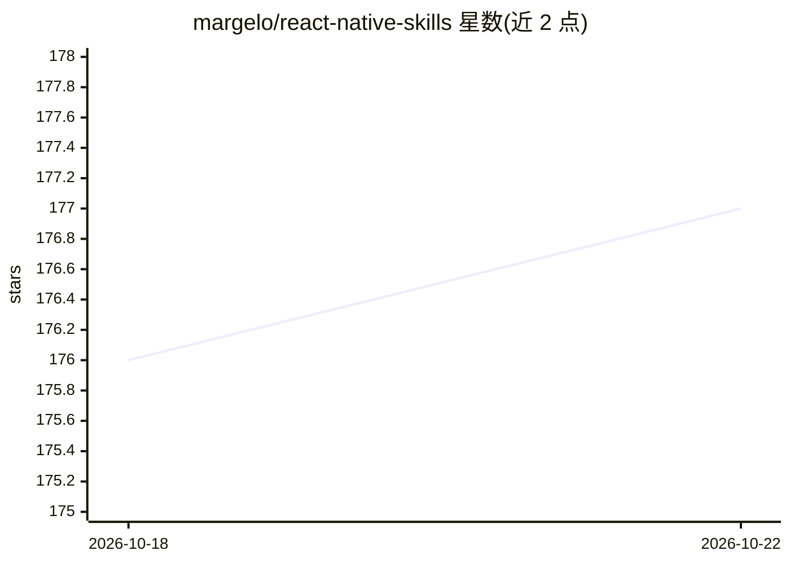

# margelo/react-native-skills

⭐ 177 · 推送 2026-08-21 · [GitHub](https://github.com/margelo/react-native-skills) · [官网](https://margelo.com) · 组织维护

**面向 React Native 的 Agent Skills 技能集合**

由 margelo 维护的 React Native 开发类 agent 技能库：通过 npx skills add 命令安装，经交互式选择器挑选所需技能后添加到 agent 环境使用。仓库以主题标签标识涵盖 agent、LLM、React、React Native 等方向。README 篇幅极短，未列出技能清单、条目数量或具体类别，仅提供安装命令与选择流程，细节需进入仓库目录查看。

## 筛选速览

| 维度 | 判定 | 备注 |
|---|---|---|
| AI 角色 | `ai-knowledge` | 知识聚合/清单类 |
| 许可风险 | `none` | — |
| 部署形态 | `library` | 以包/库形式分发 |
| 模型依赖 | — | README 未给出锁定关系 |
| 硬件要求 | — | 无带数字的原话,不猜 |
| 安装摩擦 | `low` | 无编译、无系统依赖或容器化 |
| 成熟度 | — | 结构信号不足 |

## 能力要点

- 通过 npx skills add 命令安装技能
- 交互式选择器按需挑选技能
- 面向 React Native 开发场景的 agent 技能

## 适用场景

- 为编码 agent 添加 React Native 开发技能
- 在 agent 环境中按需选用移动端开发能力

## 场景标签

 · 领域:移动开发/Agent 技能

## 证据(README 行号)

> L2: The best react-native Agent Skills. Forget 10x, this is 100x.
> L7: npx skills add margelo/react-native-skills

## 星数曲线

2026-10-18 176 → 2026-10-22 177（+1）

---
*卡片 v1 · prompt 1.4 · 生成 2026-10-22 · 置信度 low · 依据 README sha `880a09f2a0ef` · [字段定义](../../DATASET.md)*
