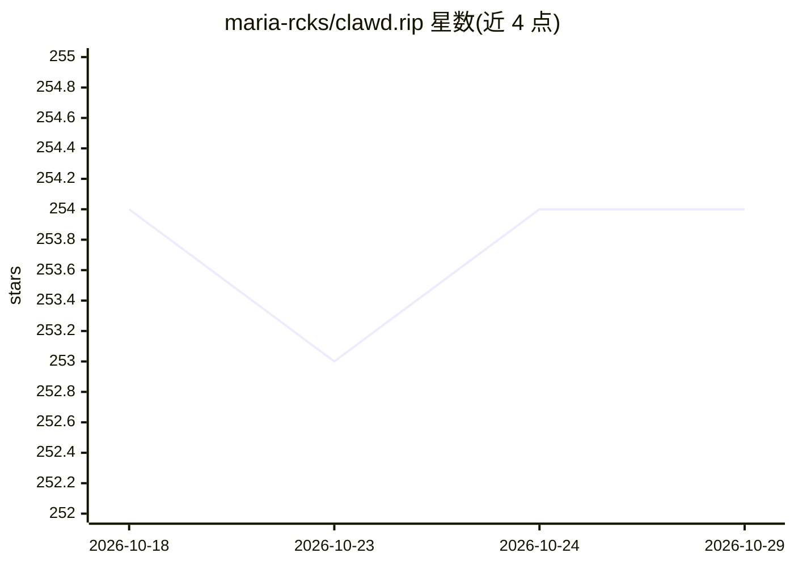

# maria-rcks/clawd.rip

⭐ 254 · TypeScript · MIT · 推送 2026-07-21 · [GitHub](https://github.com/maria-rcks/clawd.rip) · [官网](https://clawd.rip) · 个人维护

**与 Claude 相关的独立 Web 项目，内容仅见免责声明**

README 仅包含预览标题与免责声明：声明该项目为独立项目，与 Anthropic PBC 无隶属、背书或赞助关系，Anthropic 与 Claude 相关商标归各自所有。仓库主题标签涉及 agent、claude、claudecode、llm 等，但页面内未展示功能、安装或使用说明，无法从可见文本确认其具体用途与目标用户。

## 筛选速览

| 维度 | 判定 | 备注 |
|---|---|---|
| AI 角色 | `ai-ecosystem` | LLM/agent 周边工具 |
| 许可风险 | `permissive` | MIT |
| 部署形态 | `None` |  |
| 模型依赖 | — | README 未给出锁定关系 |
| 硬件要求 | — | 无带数字的原话,不猜 |
| 安装摩擦 | `low` | 无编译、无系统依赖或容器化 |
| 成熟度 | — | 结构信号不足 |

## 能力要点

- 声明与 Anthropic PBC 无隶属、背书或赞助关系
- 主题标签涉及 claude、claudecode、agent、llm

## 适用场景

- 因信息不足，无法给出适用场景

## 场景标签

 · 领域:不明

## 证据(README 行号)

> L3: Independent project. Not affiliated with, endorsed by, or sponsored by Anthropic PBC. Anthropic, Claude.

## 星数曲线

2026-10-18 254 → 2026-10-29 254（+0）

---
*卡片 v1 · prompt 1.4 · 生成 2026-10-22 · 置信度 low · 依据 README sha `44ca0acf841c` · [字段定义](../../DATASET.md)*
