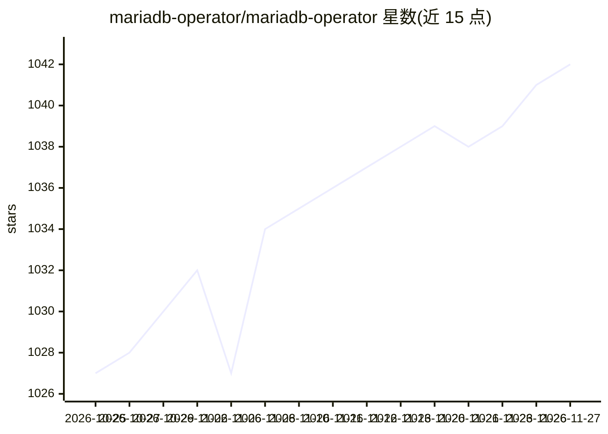

# mariadb-operator/mariadb-operator

⭐ 1,042 · Go · MIT · 推送 2026-11-26 · [GitHub](https://github.com/mariadb-operator/mariadb-operator) · [官网](https://github.com/mariadb-operator/mariadb-operator/blob/main/docs/README.md) · 组织维护

**在 Kubernetes 上声明式运维 MariaDB 的云原生 Operator**

基于 Kubernetes CRD 管理 MariaDB 的 Operator：支持单机实例、异步复制、Galera 同步多主、跨集群复制与 MaxScale 代理等高可用拓扑；备份方面覆盖 mariadb-backup 物理备份与 mariadb-dump 逻辑备份，支持 S3、Azure Blob、PVC 等存储后端、时间点恢复与实例引导；并提供 TLS 证书轮换、root 密码轮换、滚动更新、蓝绿零停机升级、Prometheus 指标与 cert-manager 集成。通过 Helm、OLM 或静态清单安装，仅兼容官方 MariaDB 镜像（>=10.6）与 Kubernetes >=1.31。README 未描述 AI 相关功能。

## 筛选速览

| 维度 | 判定 | 备注 |
|---|---|---|
| AI 角色 | `ai-enhanced` | 去掉 AI 部分产品仍成立 |
| 许可风险 | `permissive` | MIT |
| 部署形态 | `library` | 以包/库形式分发 |
| 模型依赖 | — | README 未给出锁定关系 |
| 硬件要求 | — | 无带数字的原话,不猜 |
| 安装摩擦 | `low` | 无编译、无系统依赖或容器化 |
| 成熟度 | — | 结构信号不足 |

## 能力要点

- 异步复制、Galera 多主、跨集群复制与 MaxScale 代理多种拓扑
- 物理/逻辑备份与 Point-In-Time-Recovery（归档 binary log）
- 零停机蓝绿升级与 ReplicasFirstPrimaryLast 滚动更新
- 原生集成 cert-manager 与 prometheus-operator

## 适用场景

- 在 Kubernetes 集群中以声明式方式部署和管理 MariaDB
- 为多区域部署配置跨集群复制与灾难恢复
- 为数据库配置定时备份、加密与时间点恢复
- 以 GitOps 流程管理数据库的升级与运维

## 场景标签

 · 领域:云原生/数据库运维

## 证据(README 行号)

> L19: Run and operate MariaDB in a cloud native way. Declaratively manage your MariaDB using Kubernetes CRDs rather than 
> L53: - Install it using helm, OLM or static manifests.
> L115: For enterprise users, see the __MariaDB Enterprise Operator__, a commercially supported Kubernetes operator from M

## 星数曲线

2026-10-25 1,027 → 2026-11-27 1,042（+15）

---
*卡片 v1 · prompt 1.4 · 生成 2026-11-24 · 置信度 mid · 依据 README sha `69fa3da45bca` · [字段定义](../../DATASET.md)*
