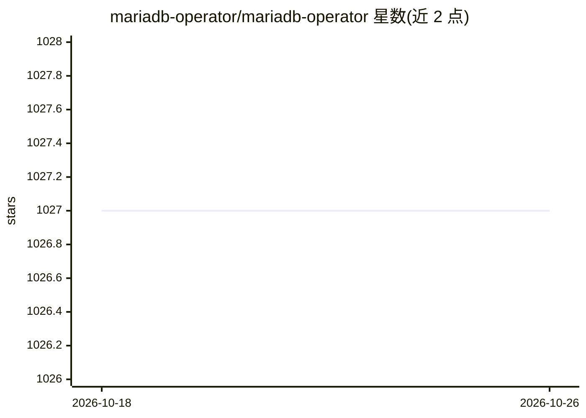

# mariadb-operator/mariadb-operator

⭐ 1,027 · Go · MIT · 推送 2026-10-25 · [GitHub](https://github.com/mariadb-operator/mariadb-operator) · [官网](https://github.com/mariadb-operator/mariadb-operator/blob/main/docs/README.md) · 组织维护

**Kubernetes 上以 CRD 声明式运维 MariaDB 的 operator**

mariadb-operator 是一个用 Go 编写的 Kubernetes operator，通过自定义资源（CRD）声明式管理 MariaDB：支持单机与多种高可用拓扑（异步复制、Galera 多主、多集群跨集群复制、MaxScale 代理），提供物理/逻辑备份到 S3/Azure/PVC 等存储、按时间点恢复、零停机蓝绿升级、TLS 证书签发轮换、与 cert-manager 和 prometheus-operator 的集成。仅兼容官方 MariaDB 镜像，要求 MariaDB>=10.6、Kubernetes>=1.31。通过 Helm、OLM 或静态清单安装。README 正文未描述 AI 功能（仓库主题标签含 agent-skills/agentic-ai）。

## 筛选速览

| 维度 | 判定 | 备注 |
|---|---|---|
| AI 角色 | `ai-enhanced` | 去掉 AI 部分产品仍成立 |
| 许可风险 | `permissive` | MIT |
| 部署形态 | `library` | 以包/库形式分发 |
| 模型依赖 | — | README 未给出锁定关系 |
| 硬件要求 | — | 无带数字的原话,不猜 |
| 安装摩擦 | `low` | 无编译、无系统依赖或容器化 |
| 成熟度 | — | 结构信号不足 |

## 能力要点

- 多种高可用拓扑：异步复制、Galera 多主、多集群跨集群复制、MaxScale
- 物理/逻辑备份支持 S3/Azure/PVC/VolumeSnapshots，含时间点恢复
- 零停机蓝绿升级与滚动更新（ReplicasFirstPrimaryLast）
- 与 cert-manager、prometheus-operator 原生集成

## 适用场景

- 在 Kubernetes 上声明式部署和管理 MariaDB 集群
- 为 MariaDB 配置备份、加密与时间点恢复
- 多区域部署下做跨集群复制与蓝绿升级

## 场景标签

 · 领域:云原生/数据库运维

## 证据(README 行号)

> L14: # 🦭 mariadb-operator
> L16: Run and operate MariaDB in a cloud native way. Declaratively manage your MariaDB using Kubernetes CRDs rather than 

## 星数曲线

2026-10-18 1,027 → 2026-10-26 1,027（+0）

---
*卡片 v1 · prompt 1.4 · 生成 2026-10-21 · 置信度 low · 依据 README sha `fdd1f22c378e` · [字段定义](../../DATASET.md)*
