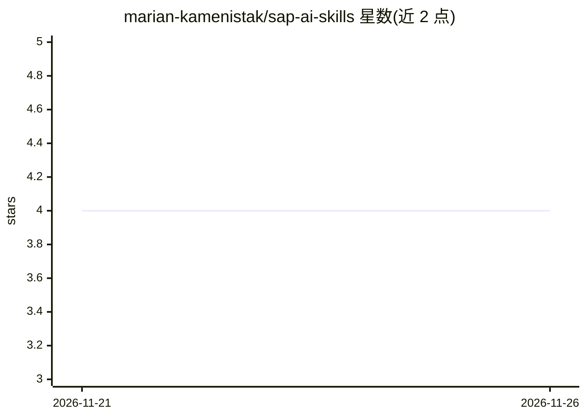

# marian-kamenistak/sap-ai-skills

⭐ 4 · JavaScript · MIT · 推送 2026-11-09 · [GitHub](https://github.com/marian-kamenistak/sap-ai-skills) · [官网](https://www.engineeringleaders.io/academy/sap-skills) · 个人维护

**为 SAP ABAP 团队提供的 10 个 AI 技能集**

面向 SAP ABAP 开发周期的技能集合，将一次变更从 Jira 工单推进到传输发布，每个阶段对应一个技能（spec-grill、implement、code-review、bugfix 等）。每个技能是书面流程：步骤、人工确认门、规则与产出。以 Claude Code 插件形式安装，或作为 GitHub Copilot 提示文件与 agent skills 使用；支持三种 AI 接入 SAP 的方式（可写 MCP 服务器、只读 MCP 服务器、abapGit 导出文件）。内置安全规则：仅限 DEV 环境、不读取数据、由人审批与发布传输。

## 筛选速览

| 维度 | 判定 | 备注 |
|---|---|---|
| AI 角色 | `ai-ecosystem` | LLM/agent 周边工具 |
| 许可风险 | `permissive` | MIT |
| 部署形态 | `None` |  |
| 模型依赖 | — | README 未给出锁定关系 |
| 硬件要求 | — | 无带数字的原话,不猜 |
| 安装摩擦 | `low` | 无编译、无系统依赖或容器化 |
| 成熟度 | — | 结构信号不足 |

## 能力要点

- 10 个技能覆盖 specify 到 bugfix 的完整开发周期
- 可在 Claude Code 插件与 GitHub Copilot 提示文件/skills 两种形态使用
- 三种 AI 接入 SAP 的途径：ADT MCP 服务器（读/写）、只读 MCP、abapGit 导出文件
- 内置安全规则：DEV only、无生产与个人数据、人工审批与发布传输

## 适用场景

- ABAP 团队用 Claude Code 按流程推进一次变更的各个阶段
- 在 Copilot Chat 中按技能名调用审查、重构或文档生成流程
- 通过 MCP 服务器让 AI 读取 DEV 环境源码并运行 ATC 检查

## 场景标签

`代码审查` `编码 Agent` `提示工程` · 领域:Agent 开发

## 证据(README 行号)

> L3: 10 skills that take an SAP ABAP change from a Jira ticket to a released transport with AI, one
> L4: skill per stage of the development cycle. They work in Claude Code as a plugin and in GitHub

## 星数曲线

2026-11-21 4 → 2026-11-26 4（+0）

---
*卡片 v1 · prompt 1.4 · 生成 2026-11-21 · 置信度 high · 依据 README sha `53bdbcbcef47` · [字段定义](../../DATASET.md)*
