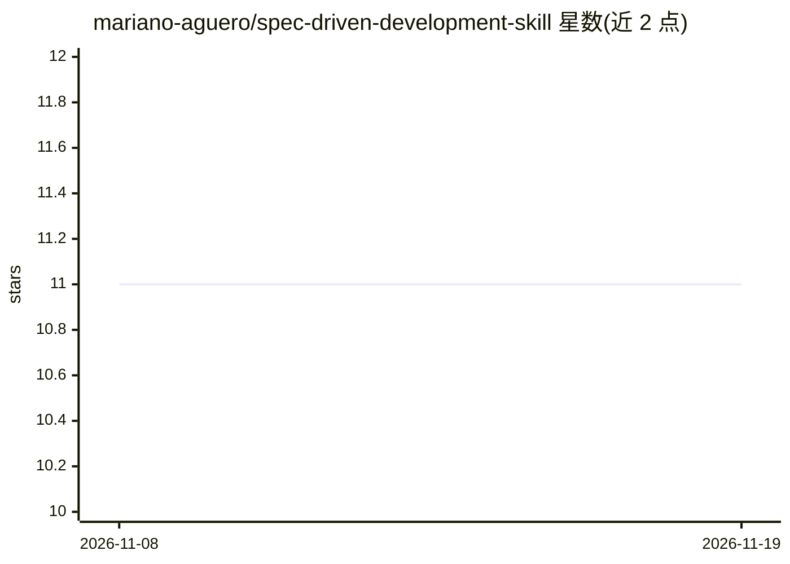

# mariano-aguero/spec-driven-development-skill

⭐ 11 · JavaScript · MIT · 推送 2026-11-05 · [GitHub](https://github.com/mariano-aguero/spec-driven-development-skill) · 个人维护

**为 AI 编码 agent 提供规范驱动开发流程的技能包**

一个 Agent Skill，将非正式提示词转化为结构化、可追溯的规格说明，供 AI 编码 agent 执行。工作流覆盖 constitution→research→specify→plan→tasks→implement→validate 六个阶段，含漂移检测、MoSCoW 优先级验收标准与质量门。按变更规模提供 S/M/L 三档强度，支持 delta spec 增量修订与 /sdd-change 变更分类。通过 npx skills 或 Claude Code 插件市场安装，提供 /sdd-* 系列命令、Node 20+ 的规格校验脚本及 12 个行为评估场景。

## 筛选速览

| 维度 | 判定 | 备注 |
|---|---|---|
| AI 角色 | `ai-ecosystem` | LLM/agent 周边工具 |
| 许可风险 | `permissive` | MIT |
| 部署形态 | `library` | 以包/库形式分发 |
| 模型依赖 | — | README 未给出锁定关系 |
| 硬件要求 | — | 无带数字的原话,不猜 |
| 安装摩擦 | `low` | 无编译、无系统依赖或容器化 |
| 成熟度 | — | 结构信号不足 |

## 能力要点

- constitution→specify→plan→tasks→implement→validate 阶段式工作流与质量门
- 漂移检测、追溯矩阵与契约冻结的 pre-write hook
- S/M/L 三档变更强度与 delta spec 增量基线机制
- Node 20+ 无依赖的 sdd-check.mjs 规格校验脚本（--json 支持 CI）

## 适用场景

- AI 生成代码频繁偏离需求约束或多次会话结果不一致时建立规格基线
- 涉及鉴权、数据库 schema 或公共 API 的功能开发前先写规格与契约
- 热修复后用 /sdd-change 将代码改动回溯同步到规格
- 团队在写代码前建立共享的技术理解与评审点

## 场景标签

`提示工程` `编码 Agent` · 领域:Agent 开发

## 证据(README 行号)

> L17: > An **Agent Skill** that turns informal prompts into structured, traceable, drift-resistant
> L20: Compatible with Claude Code, Cursor, GitHub Copilot, JetBrains Junie, Windsurf, and similar tools.
> L105: npx skills add mariano-aguero/spec-driven-development-skill

## 星数曲线

2026-11-08 11 → 2026-11-19 11（+0）

---
*卡片 v1 · prompt 1.4 · 生成 2026-11-18 · 置信度 high · 依据 README sha `f69b833e5ff9` · [字段定义](../../DATASET.md)*
