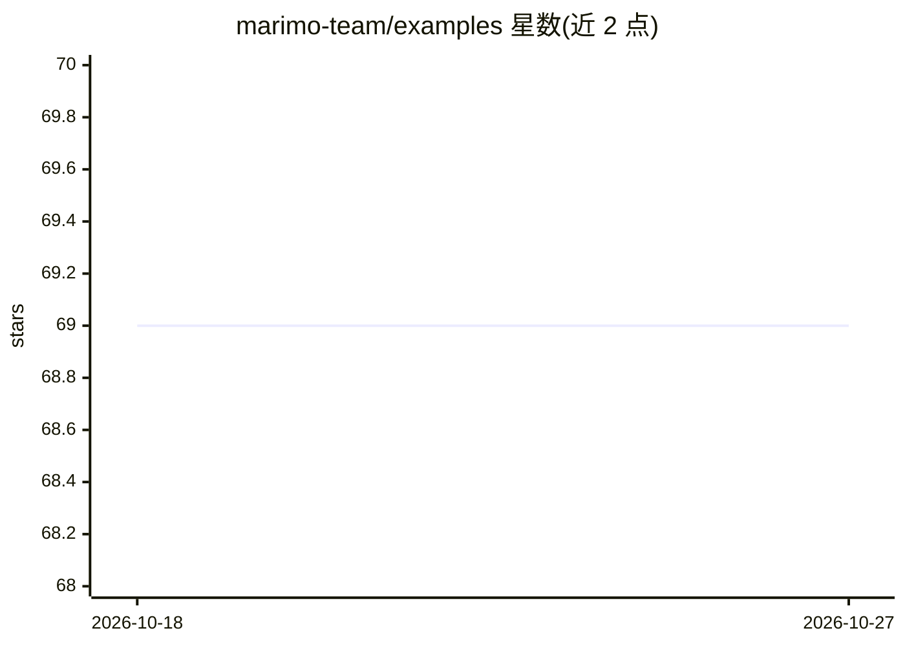

# marimo-team/examples

⭐ 69 · Python · MIT · 推送 2026-10-19 · [GitHub](https://github.com/marimo-team/examples) · [官网](https://marimo.io) · 组织维护

**marimo 示例笔记本策展集，供数据探索与工作流起步**

marimo 团队维护的示例笔记本集合：收录可用于数据探索、实验、工作流与应用的 marimo notebook 模板。每个示例附带各自的 README 说明本地运行方式，多数示例可通过其 README 中的 'open in marimo' 徽章在 marimo 在线 playground 打开。仓库接受社区贡献，贡献清单要求示例独立成文件夹、用 --sandbox 声明包依赖、附简短 README 与自定义数据/模型适配说明；也可通过 issue 请求新示例。仓库本身不含统一安装命令。

## 筛选速览

| 维度 | 判定 | 备注 |
|---|---|---|
| AI 角色 | `ai-knowledge` | 知识聚合/清单类 |
| 许可风险 | `permissive` | MIT |
| 部署形态 | `None` |  |
| 模型依赖 | — | README 未给出锁定关系 |
| 硬件要求 | — | 无带数字的原话,不猜 |
| 安装摩擦 | `low` | 无编译、无系统依赖或容器化 |
| 成熟度 | — | 结构信号不足 |

## 能力要点

- 策展的 marimo 示例笔记本模板集合
- 每个示例有独立 README 说明本地运行方式
- 多数示例可在 marimo 在线 playground 直接打开
- 接受社区 PR 贡献新示例，规范依赖声明与适配说明

## 适用场景

- 为数据探索和实验寻找 marimo notebook 起步模板
- 学习如何组织可复现的 marimo 示例（依赖沙箱化）
- 参考他人工作流与应用的搭建方式

## 场景标签

`精选清单` · 领域:学习与行业

## 证据(README 行号)

> L1: A curated collection of example marimo notebooks.
> L3: This repository contains a curated collection of example

## 星数曲线

2026-10-18 69 → 2026-10-27 69（+0）

---
*卡片 v1 · prompt 1.4 · 生成 2026-10-24 · 置信度 high · 依据 README sha `13058bde07fc` · [字段定义](../../DATASET.md)*
