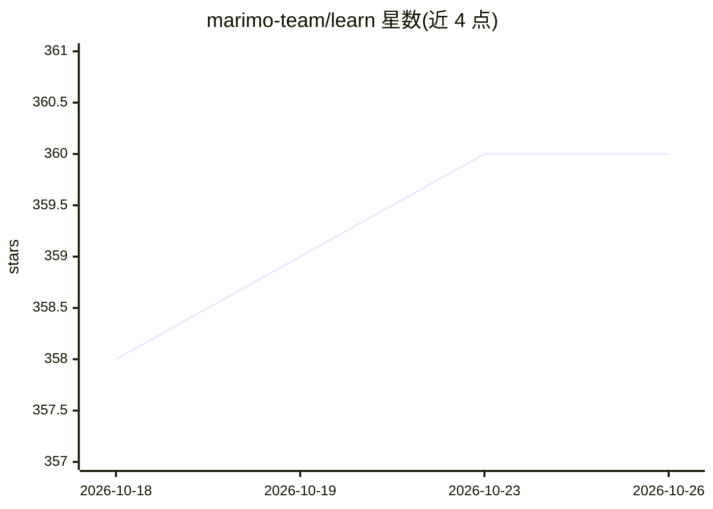

# marimo-team/learn

⭐ 360 · Python · MIT · 推送 2026-04-30 · [GitHub](https://github.com/marimo-team/learn) · [官网](https://marimo-team.github.io/learn/) · 组织维护

**教育用途的 marimo notebook 策展合集，按课程组织**

由 marimo 团队维护的教育性 notebook 策展仓库：以 marimo Python notebook 为载体，按课程（Python 基础、优化等）组织讲解计算机科学、线性 algebra、概率、机器学习等学术主题，以及 polars、pytorch、matplotlib 等常用库的应用。面向教育者、学生与从业者，通过 issue 提案与 PR 评审接受社区贡献，要求 notebook 内含依赖声明。仓库含构建脚本，可将 notebook 导出为 HTML 并生成索引页。

## 筛选速览

| 维度 | 判定 | 备注 |
|---|---|---|
| AI 角色 | `ai-knowledge` | 知识聚合/清单类 |
| 许可风险 | `permissive` | MIT |
| 部署形态 | `None` |  |
| 模型依赖 | — | README 未给出锁定关系 |
| 硬件要求 | — | 无带数字的原话,不猜 |
| 安装摩擦 | `low` | 无编译、无系统依赖或容器化 |
| 成熟度 | — | 结构信号不足 |

## 能力要点

- 按课程组织的 marimo notebook 教育合集
- 覆盖 CS、线性代数、概率、机器学习及 polars/pytorch 等库教学
- 通过 issue 提案 + PR 评审流程接受社区贡献
- 提供构建脚本将 notebook 导出为 HTML 站点

## 适用场景

- 学习 Python、概率、机器学习等基础概念
- 查找可直接运行的 marimo 教学 notebook 用于授课
- 为课程贡献自己的 notebook 并参与评审

## 场景标签

`教程课程` · 领域:学习与行业

## 证据(README 行号)

> L1: A curated collection of educational marimo notebooks || 💬 Discord
> L5: This repository contains a curated collection of educational
> L12: Our goal with `marimo learn` is to create a central repository of high quality

## 星数曲线

2026-10-18 358 → 2026-10-26 360（+2）

---
*卡片 v1 · prompt 1.4 · 生成 2026-10-21 · 置信度 high · 依据 README sha `fdeb8c3da448` · [字段定义](../../DATASET.md)*
