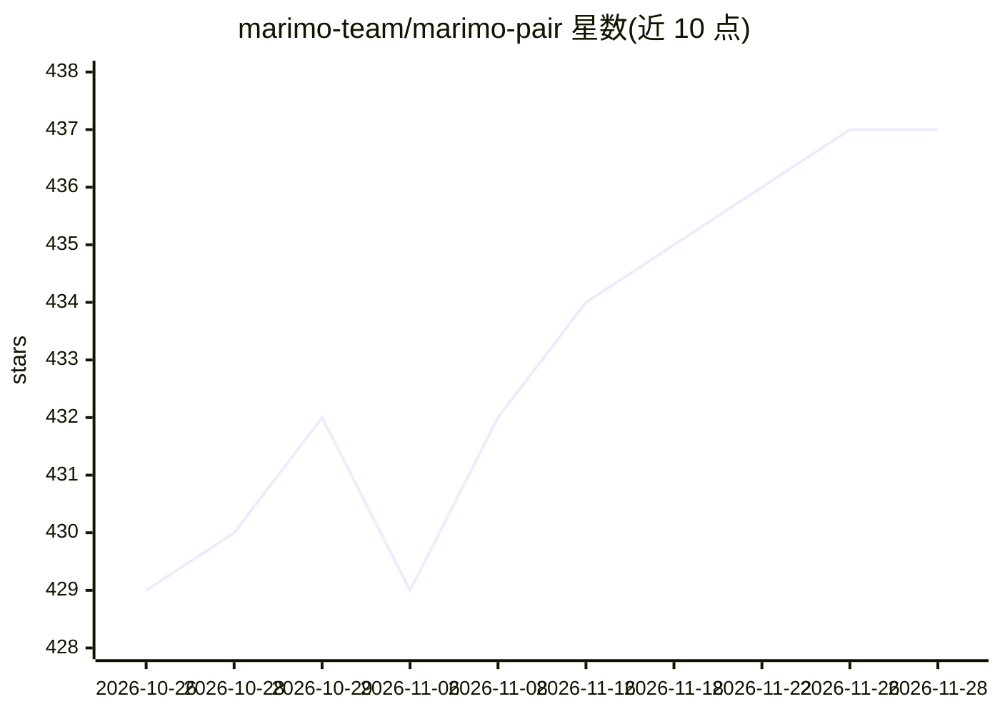

# marimo-team/marimo-pair

⭐ 437 · Shell · Apache-2.0 · 推送 2026-11-25 · [GitHub](https://github.com/marimo-team/marimo-pair) · 组织维护

**教编码 agent 与用户共编 marimo notebook 的技能**

以 Agent Skills 形式分发的技能包：让编码 agent 通过 Pair CLI（marimo pair）或 MCP 进入正在运行的响应式 Python notebook，与人共享同一会话，双方均可检查数据、编辑单元格并查看结果。支持任何符合 Agent Skills 开放标准的 agent，另提供 Claude Code 插件与 OpenCode HTTP 目录两种安装途径；前提是环境中已有 marimo 0.26+ 或 uv。

## 筛选速览

| 维度 | 判定 | 备注 |
|---|---|---|
| AI 角色 | `ai-ecosystem` | LLM/agent 周边工具 |
| 许可风险 | `permissive` | Apache-2.0 |
| 部署形态 | `library` | 以包/库形式分发 |
| 模型依赖 | — | README 未给出锁定关系 |
| 硬件要求 | — | 无带数字的原话,不猜 |
| 安装摩擦 | `low` | 无编译、无系统依赖或容器化 |
| 成熟度 | — | 结构信号不足 |

## 能力要点

- agent 经 Pair CLI 或 MCP 加入运行中的 marimo notebook 会话
- 兼容 Agent Skills 开放标准的任意 agent
- 提供 Claude Code 插件市场安装与 OpenCode HTTP 目录接入

## 适用场景

- 让编码 agent 与我在同一 notebook 中共同检查数据和编辑单元格
- 为支持 Agent Skills 标准的 agent 增加操作 marimo 的能力

## 场景标签

`编码 Agent` · 领域:编码与开发

## 证据(README 行号)

> L7: marimo-pair is a skill that teaches your coding
> L8: agent to use the Pair CLI (`marimo pair`) or MCP to work in the same reactive
> L20: Works with any agent that supports the Agent Skills

## 星数曲线

2026-10-26 429 → 2026-11-28 437（+8）

---
*卡片 v1 · prompt 1.4 · 生成 2026-11-26 · 置信度 high · 依据 README sha `340196791f22` · [字段定义](../../DATASET.md)*
