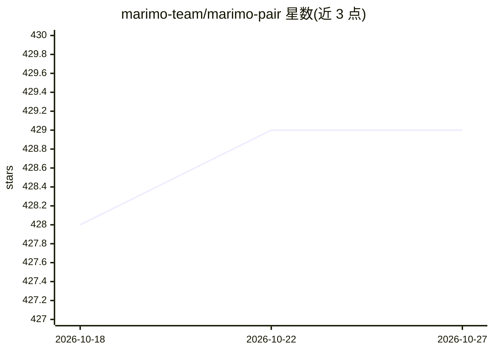

# marimo-team/marimo-pair

⭐ 429 · Shell · Apache-2.0 · 推送 2026-09-16 · [GitHub](https://github.com/marimo-team/marimo-pair) · 组织维护

**让 agent 接入运行中 marimo 笔记本会话的技能/插件**

marimo 团队发布的 agent 技能包与 Claude Code 插件，把响应式 Python 笔记本会话作为 agent 可操作的环境。前提是已运行 marimo 笔记本（--no-token 可自动发现，带认证的服务器需 MARIMO_TOKEN 环境变量），并要求 PATH 上有 bash、curl、jq（Windows 需在 Git Bash 或 WSL 中运行）。支持任何兼容 Agent Skills 开放标准的 agent，通过 npx skills add 安装，或作为 Claude Code 插件经 marketplace 安装。

## 筛选速览

| 维度 | 判定 | 备注 |
|---|---|---|
| AI 角色 | `ai-ecosystem` | LLM/agent 周边工具 |
| 许可风险 | `permissive` | Apache-2.0 |
| 部署形态 | `library` | 以包/库形式分发 |
| 模型依赖 | locked-api |  |
| 硬件要求 | — | 无带数字的原话,不猜 |
| 安装摩擦 | `low` | 无编译、无系统依赖或容器化 |
| 成熟度 | — | 结构信号不足 |

## 能力要点

- 将运行中的 marimo notebook 会话暴露为 agent 环境
- 兼容 Agent Skills 开放标准，适配任意支持的 agent
- 提供 Claude Code 插件分发渠道与自动更新选项

## 适用场景

- 让 Claude Code 等 agent 直接操作我的 marimo 笔记本会话
- 在笔记本环境中执行 agent 任务并复用其响应式状态

## 场景标签

 · 领域:AI 工具集成/笔记本

## 证据(README 行号)

> L3:  reactive Python notebooks as environments for agents
> L19: Works with any agent that supports the Agent Skills

## 星数曲线

2026-10-18 428 → 2026-10-27 429（+1）

---
*卡片 v1 · prompt 1.4 · 生成 2026-10-21 · 置信度 high · 依据 README sha `eae37b8f03e2` · [字段定义](../../DATASET.md)*
