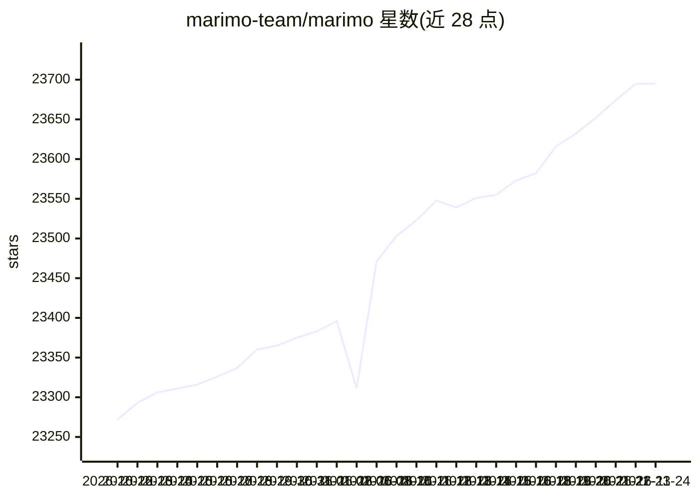

# marimo-team/marimo

⭐ 23,714 · Python · Apache-2.0 · 推送 2026-11-24 · [GitHub](https://github.com/marimo-team/marimo) · [官网](https://marimo.io) · 组织维护

**反应式 Python 笔记本：可复现实验、SQL 查询、可部署为应用**

marimo 是一个反应式 Python 笔记本环境：运行某个单元格时自动执行依赖它的单元格或标记为过期，消除隐藏状态；笔记本以纯 Python 文件存储，可按脚本执行、部署为 Web 应用、用 git 做版本管理，并内置 SQL 引擎查询 dataframe/数据库/lakehouse。面向数据科学与开发者群体。AI 相关能力为可选项：编辑器内置 AI 补全（可自带 API key 或本地模型）、提供 marimo pair 与 Claude Code 等 agent 协作。通过 pip/conda 安装，提供 Jupyter 笔记本转换 CLI 与 VS Code 扩展。

## 筛选速览

| 维度 | 判定 | 备注 |
|---|---|---|
| AI 角色 | `ai-enhanced` | 去掉 AI 部分产品仍成立 |
| 许可风险 | `permissive` | Apache-2.0 |
| 部署形态 | `library` | 以包/库形式分发 |
| 模型依赖 | — | README 未给出锁定关系 |
| 硬件要求 | — | 无带数字的原话,不猜 |
| 安装摩擦 | `low` | 无编译、无系统依赖或容器化 |
| 成熟度 | — | 结构信号不足 |

## 动量与使用信号

- 维护:`active` — 距上次 push 1.2 天,年发版 52,355 位贡献者
- 涨星:近 1 天 **+26**(自 20261016 起算)
- 安装:pypi 包 `marimo` 月下载 2,450,932
- 平台:WEB · 协议:—

## 能力要点

- 反应式执行：运行单元格自动更新依赖单元格，执行顺序由变量引用决定
- 笔记本存储为纯 .py 文件，可作脚本执行、部署为 Web 应用或幻灯片
- 内置 SQL 引擎，查询结果以 Python dataframe 返回
- 编辑器内置 AI 补全与 marimo pair，可搭配 Claude Code/Codex 等 agent

## 适用场景

- 替代传统笔记本做可复现的数据科学实验
- 把分析笔记本一键部署成交互式 Web 应用或幻灯片
- 用 SQL 与 Python 混合查询 dataframe、数据库与 lakehouse
- 在编辑器中借助 AI 补全与 agent 生成数据处理代码

## 场景标签

 · 领域:开发者工具/数据科学

## 证据(README 行号)

> L23: **marimo** is a reactive Python notebook: run a cell or interact with a UI
> L35: - 🤖 **AI-native**: pair with AI agents like Claude Code, or use our editor's built-in AI features
> L130: pip install marimo  # or conda install -c conda-forge marimo

## 星数曲线

2026-10-22 23,272 → 2026-11-24 23,695（+423）

---
*卡片 v1 · prompt 1.4 · 生成 2026-11-23 · 置信度 high · 依据 README sha `f9db94b627b9` · [字段定义](../../DATASET.md)*
