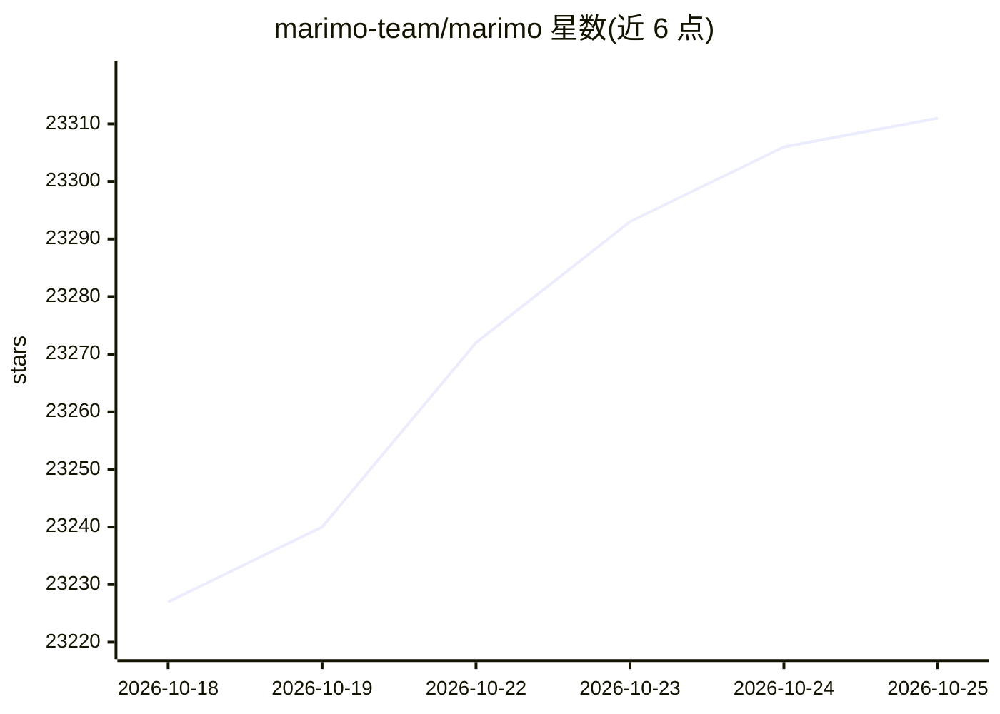

# marimo-team/marimo

⭐ 23,311 · Python · Apache-2.0 · 推送 2026-10-24 · [GitHub](https://github.com/marimo-team/marimo) · [官网](https://marimo.io) · 组织维护 · 中文 README

**反应式 Python 笔记本：可复现实验、SQL 查询、可部署为应用**

一个反应式 Python 笔记本环境：运行或交互某个单元格时自动执行依赖单元格或标记为过期，消除隐藏状态，按变量引用确定性执行。笔记本以纯 Python 文件存储，可用 git 版本管理，可作为脚本执行或部署为 Web 应用。内置 SQL 引擎可查询 dataframe、数据库等，支持包管理序列化到文件并在隔离 venv 中自动安装。提供 VS Code 扩展、PyCharm 插件，支持 Jupyter 笔记本一键转换，可配合 Claude Code 等 agent 或使用编辑器内置 AI 补全（可自带 API key 或本地模型）。

## 筛选速览

| 维度 | 判定 | 备注 |
|---|---|---|
| AI 角色 | `ai-native` | 本体是模型或模型工具 |
| 许可风险 | `permissive` | Apache-2.0 |
| 部署形态 | `library` | 以包/库形式分发 |
| 模型依赖 | — | README 未给出锁定关系 |
| 硬件要求 | — | 无带数字的原话,不猜 |
| 安装摩擦 | `low` | 无编译、无系统依赖或容器化 |
| 成熟度 | — | 结构信号不足 |

## 动量与使用信号

- 维护:`active` — 距上次 push 1.2 天,年发版 52,355 位贡献者
- 涨星:近 1 天 **+26**(自 20261016 起算)
- 安装:pypi 包 `marimo` 月下载 2,450,932
- 平台:WEB · 协议:—

## 能力要点

- 反应式执行：自动运行依赖单元格，无隐藏状态，确定性执行顺序
- 笔记本存储为纯 .py 文件，可作为脚本执行或部署为 Web 应用/幻灯片
- 内置 SQL 引擎，查询 dataframe、数据库、lakehouse、CSV、Google Sheets
- 支持 molab 云端笔记本服务与 WASM 浏览器运行

## 适用场景

- 替代 Jupyter 做可复现的数据科学实验
- 把分析笔记本一键变成可分享的交互式 Web 应用
- 在笔记本中混合 Python 与 SQL 查询数据仓库
- 让 Claude Code 等 agent 与笔记本协作生成代码

## 场景标签

 · 领域:开发者工具/数据科学

## 证据(README 行号)

> L23: **marimo** is a reactive Python notebook: run a cell or interact with a UI
> L35: - 🤖 **AI-native**: pair with AI agents like Claude Code, or use our editor's built-in AI features
> L91: CSVs, Google Sheets, or anything else using our built-in SQL engine, which

## 星数曲线

2026-10-18 23,227 → 2026-10-25 23,311（+84）

---
*卡片 v1 · prompt 1.4 · 生成 2026-10-18 · 置信度 high · 依据 README sha `093ab134d230` · [字段定义](../../DATASET.md)*
