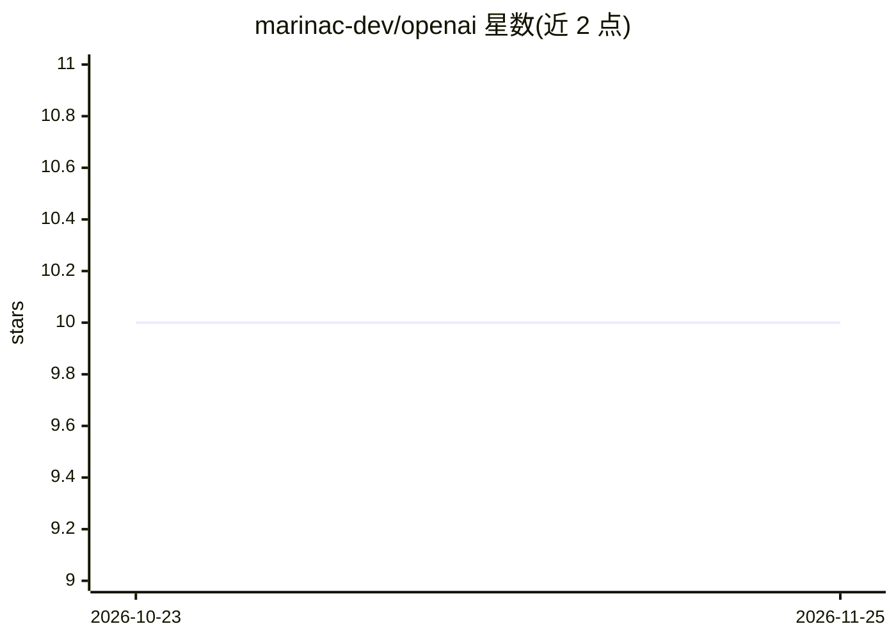

# marinac-dev/openai

⭐ 10 · Elixir · MIT · 推送 2026-11-13 · [GitHub](https://github.com/marinac-dev/openai) · 个人维护

**为 Elixir 开发者提供 OpenAI REST API 客户端库，支持流式响应**

面向 Elixir 生态的 OpenAI REST API 客户端库，覆盖 JSON 请求、SSE 流式事件、multipart 上传、二进制响应、自动重试与标准化错误。以 Git 依赖方式接入 mix.exs 项目，客户端可显式创建或通过应用配置设置默认值，base_url 可改为 OpenAI 兼容网关或本地测试服务器。模块按资源域组织（Responses、Chat、Files、Media、FineTuning、Agents 等），请求体保持 map 形式以便使用未发布的新字段。

## 筛选速览

| 维度 | 判定 | 备注 |
|---|---|---|
| AI 角色 | `ai-ecosystem` | LLM/agent 周边工具 |
| 许可风险 | `permissive` | MIT |
| 部署形态 | `None` |  |
| 模型依赖 | — | README 未给出锁定关系 |
| 硬件要求 | — | 无带数字的原话,不猜 |
| 安装摩擦 | `low` | 无编译、无系统依赖或容器化 |
| 成熟度 | — | 结构信号不足 |

## 能力要点

- 流式响应逐事件解码输出，Chat Completions 流可折叠回 chat.completion 对象（含 tool calls 与 usage）
- 覆盖 OpenAI OpenAPI 文档中的每个操作并生成对应资源函数
- 支持 Webhook 校验解码、multipart 上传与任意端点的直接请求
- 网络错误与 HTTP 408/409/429/5xx 自动重试（可配 max_retries）

## 适用场景

- 在 Elixir/Phoenix 应用中接入 OpenAI API 的聊天、嵌入、音频、图像等接口
- 以流式方式接收模型输出并逐事件处理
- 通过修改 base_url 将同一客户端指向 OpenAI 兼容网关
- 在服务端验证并解码 OpenAI Webhook 事件

## 场景标签

 · 领域:LLM 基础设施/API 客户端

## 证据(README 行号)

> L3: An Elixir client for the OpenAI REST API, including JSON requests, streamed
> L10: ## Installation
> L35:   base_url: System.get_env("OPENAI_BASE_URL", "https://api.openai.com/v1"),

## 星数曲线

2026-10-23 10 → 2026-11-25 10（+0）

---
*卡片 v1 · prompt 1.4 · 生成 2026-11-19 · 置信度 high · 依据 README sha `85abc02cb89b` · [字段定义](../../DATASET.md)*
