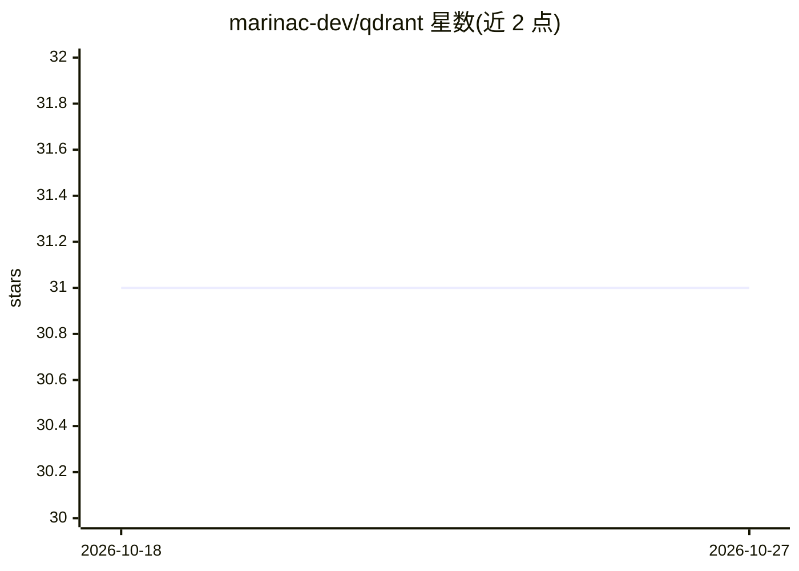

# marinac-dev/qdrant

⭐ 31 · Elixir · MIT · 推送 2026-08-10 · [GitHub](https://github.com/marinac-dev/qdrant) · 个人维护

**Qdrant 向量数据库的 Elixir REST 客户端库**

面向 Qdrant 1.18.x 的 Elixir REST 客户端库，覆盖集合与索引、点的增删查、搜索/推荐/发现/查询、快照（含流式下载与文件上传）、集群与服务操作等端点。成功调用返回完整响应信封 {:ok, body}，失败返回含 HTTP 与响应上下文的 %Qdrant.Error{}；gRPC 暂不支持。客户端可保留各自的 URL、凭证、适配器与超时设置以连接多个集群，生产适配器为 Tesla.Adapter.Finch。库处于活跃开发中，接口可能变更。

## 筛选速览

| 维度 | 判定 | 备注 |
|---|---|---|
| AI 角色 | `ai-ecosystem` | LLM/agent 周边工具 |
| 许可风险 | `permissive` | MIT |
| 部署形态 | `None` |  |
| 模型依赖 | — | README 未给出锁定关系 |
| 硬件要求 | — | 无带数字的原话,不猜 |
| 安装摩擦 | `low` | 无编译、无系统依赖或容器化 |
| 成熟度 | `idea` | |

## 能力要点

- 成功调用保留完整 Qdrant 响应信封，失败返回带上下文的 %Qdrant.Error{}
- 单应用可同时连接多个 Qdrant 集群（每客户端独立配置）
- 支持快照流式下载到文件与文件路径上传
- API key 明文 HTTP 到非回环地址默认被拒绝

## 适用场景

- 在 Elixir/Phoenix 应用中接入 Qdrant 做向量搜索
- 管理 Qdrant 集合、点、索引与快照
- 同时连接本地与 Qdrant Cloud 多个集群

## 场景标签

`向量数据库` · 领域:知识与检索

## 证据(README 行号)

> L6: An Elixir REST client targeting Qdrant 1.18.x. Successful calls preserve the
> L66: The client provides endpoint modules for:

## 星数曲线

2026-10-18 31 → 2026-10-27 31（+0）

---
*卡片 v1 · prompt 1.4 · 生成 2026-10-26 · 置信度 high · 依据 README sha `9204e8142e8a` · [字段定义](../../DATASET.md)*
