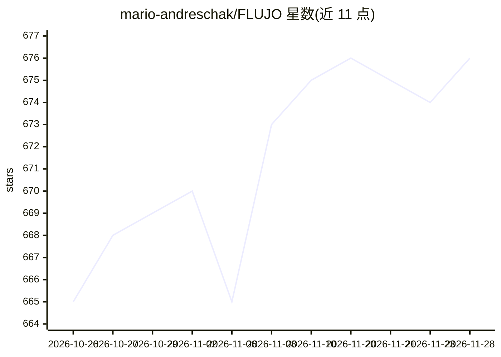

# mario-andreschak/FLUJO

⭐ 676 · TypeScript · MIT · 推送 2026-11-27 · [GitHub](https://github.com/mario-andreschak/FLUJO) · [官网](https://try.flujo.com.co) · 个人维护

**本地优先的可视化多 Agent 工作台：连接模型与工具并构建自动化**

FLUJO 是一个开源自托管的本地优先 AI 工作区：一次性保存模型与应用连接，以纯语言步骤或可视化流程图构建可复用 Agent，支持分支、循环、子流程与多 Agent 交接。提供 Talk 对话与可视化调试器（断点、单步执行、状态检查）、基于调度/Webhook/文件/工具/网页变化的自动化触发、MCP 协议的应用连接与工具检查器，并可通过 OpenAI 兼容 API 或 MCP transport 供外部客户端调用。工作区数据存储在本地。

## 筛选速览

| 维度 | 判定 | 备注 |
|---|---|---|
| AI 角色 | `ai-ecosystem` | LLM/agent 周边工具 |
| 许可风险 | `permissive` | MIT |
| 部署形态 | `desktop` | 安装包/桌面程序 |
| 模型依赖 | local-ok | 支持本地模型 |
| 硬件要求 | — | 无带数字的原话,不猜 |
| 安装摩擦 | `low` | 无编译、无系统依赖或容器化 |
| 成熟度 | — | 结构信号不足 |

## 能力要点

- 可视化 Agent 构建：Easy 纯语言步骤与 Expert 图形节点两种视图
- MCP 原生连接：支持 MCP Registry、GitHub 仓库、远程 URL、本地命令接入与工具检查器
- 自动化触发器：定时、Webhook、文件变更、工具轮询、网页变化、流程事件
- 对外暴露 OpenAI 兼容 API 与 MCP 传输端点供其他客户端复用

## 适用场景

- 把多个模型和 MCP 工具编排成带分支与循环的多步骤 Agent
- 给定时任务或文件夹监听配置自动化工作流
- 通过可视化调试器排查 Agent 的工具调用与执行路径
- 把已有流程通过 API 或 MCP 暴露给 Cursor/Cline 等客户端调用

## 场景标签

`多智能体` `工作流自动化` `Agent 框架` · 领域:Agent 开发

## 证据(README 行号)

> L14: FLUJO is an open-source, local-first AI workspace. Save your model and app connections once, build reusable agents 
> L58: - **Choose your provider:** OpenAI, Azure OpenAI, Anthropic, Google Gemini, X.ai, OpenRouter, supported subscriptio
> L70: Give agents access to files, browsers, APIs and other services through the **Model Context Protocol**.

## 星数曲线

2026-10-26 665 → 2026-11-28 676（+11）

---
*卡片 v1 · prompt 1.4 · 生成 2026-11-24 · 置信度 high · 依据 README sha `837363495b4c` · [字段定义](../../DATASET.md)*
