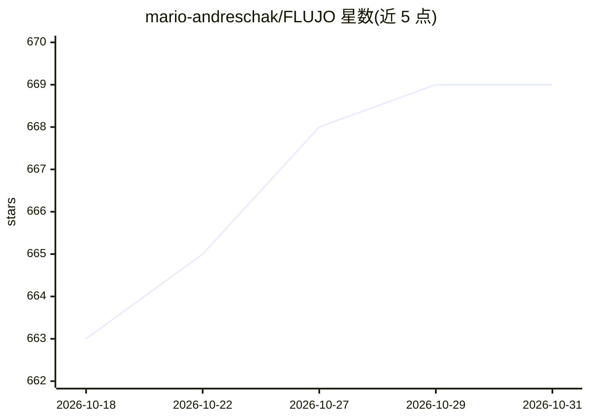

# mario-andreschak/FLUJO

⭐ 669 · TypeScript · MIT · 推送 2026-10-30 · [GitHub](https://github.com/mario-andreschak/FLUJO) · [官网](https://try.flujo.com.co) · 个人维护

**可视化构建并本地运行私有 AI agent 的开源工作台**

基于 Next.js+React 的本地优先 AI 工作台：保存模型与 MCP 应用连接后，以自然语言步骤（Easy）或可视化节点图（Expert）构建可复用 agent，支持分支、循环、子流与多模型多专家编排；提供 Talk 对话界面、可视化断点调试器、上下文窗口计量，以及按计划/Webhook/文件变化等触发的自动化。支持 OpenAI、Azure OpenAI、Anthropic、Gemini、X.ai、OpenRouter 及 Ollama 本地模型，可通过 OpenAI 兼容 API 与 MCP 端点被 Cline、Cursor 等外部客户端调用。Meetings、Personas、Waves 为实验性功能；不暴露 Ollama 兼容服务端点。

## 筛选速览

| 维度 | 判定 | 备注 |
|---|---|---|
| AI 角色 | `ai-ecosystem` | LLM/agent 周边工具 |
| 许可风险 | `permissive` | MIT |
| 部署形态 | `desktop` | 安装包/桌面程序 |
| 模型依赖 | local-ok | 支持本地模型 |
| 硬件要求 | — | 无带数字的原话,不猜 |
| 安装摩擦 | `low` | 无编译、无系统依赖或容器化 |
| 成熟度 | `idea` | |

## 能力要点

- Easy/Expert 双模式构建 agent，支持分支、循环、子流与多专家交接
- 通过 MCP 连接文件、浏览器、API 等外部工具，含工具检查器与本地 MCP 代理
- 可视化调试器（断点、单步、状态检查）与工具调用审批
- 自动化触发：定时/Webhook/文件变化/工具轮询/网页变化/流程完成
- 提供 OpenAI 兼容 API（/v1）与 MCP 端点供外部客户端复用 agent

## 适用场景

- 不用写代码，把模型和工具连起来搭一个可复用的私有 agent
- 让 agent 按日程或 Webhook 自动跑报告、监控网页变化
- 在 Cline/Cursor 等工具里复用我在 FLUJO 里搭好的 agent

## 场景标签

`多智能体` `工作流自动化` `Agent 框架` · 领域:Agent 开发

## 证据(README 行号)

> L14: FLUJO is an open-source, local-first AI workspace. Save your model and app connections once, build reusable agents 
> L97: - **Expert visual mode:** connect Start, AI, connected-app, Static, Subflow and Finish nodes in a graph.
> L212: FLUJO connects **to Ollama** as a model provider. It does not expose an Ollama-compatible server endpoint.

## 星数曲线

2026-10-18 663 → 2026-10-31 669（+6）

---
*卡片 v1 · prompt 1.4 · 生成 2026-10-21 · 置信度 high · 依据 README sha `8095b55e9161` · [字段定义](../../DATASET.md)*
