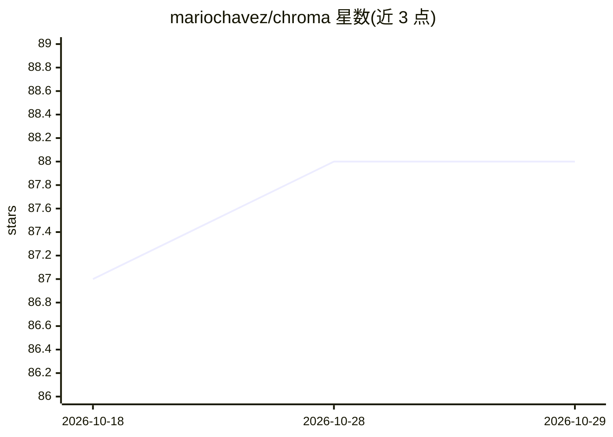

# mariochavez/chroma

⭐ 88 · Jupyter Notebook · MIT · 推送 2026-06-11 · [GitHub](https://github.com/mariochavez/chroma) · 个人维护

**Chroma 向量数据库的 Ruby 客户端，供 Ruby 应用接入**

以 Ruby gem 形式提供的 Chroma 数据库客户端：通过 Chroma API 连接客户端/服务端模式的 Chroma 实例，支持配置 api_key/tenant/database 使用 Chroma 托管服务，兼容 Chroma v2 API（需 0.6.3 及以上；旧版本 API 对应旧版 gem）。要求 Ruby 3.1.4 或更新版本，可通过 bundle add 或 gem install 安装；仓库附 Jupyter (iruby) notebook 示例，其中演示用 Ollama 与 Nomic embed text 生成嵌入。面向希望在 Ruby/Rails 技术栈中接入向量数据库的开发者。

## 筛选速览

| 维度 | 判定 | 备注 |
|---|---|---|
| AI 角色 | `ai-ecosystem` | LLM/agent 周边工具 |
| 许可风险 | `permissive` | MIT |
| 部署形态 | `library` | 以包/库形式分发 |
| 模型依赖 | — | README 未给出锁定关系 |
| 硬件要求 | — | 无带数字的原话,不猜 |
| 安装摩擦 | `low` | 无编译、无系统依赖或容器化 |
| 成熟度 | — | 结构信号不足 |

## 能力要点

- 通过 Chroma API 连接 Chroma 数据库的 Ruby 客户端
- 支持 Chroma 托管服务（api_key/tenant/database 配置）
- 对不同 Chroma 版本提供对应的 gem 版本（v1 API 用 0.8.2）
- 附 iruby notebook 示例，含 Ollama + Nomic embed text 嵌入生成示例

## 适用场景

- 在 Ruby 应用中读写 Chroma 向量数据库
- 用 Ruby 构建 LLM 应用时存储与检索嵌入
- 通过托管 Chroma 服务在 Ruby 侧使用向量检索

## 场景标签

`向量数据库` · 领域:知识与检索

## 证据(README 行号)

> L5: This Ruby gem is a client to connect to Chroma's database via its API.
> L11: Chroma-rb is a Ruby client for Chroma Database. It works with version 0.3.22 or better **(Please see requirements b
> L39: - Chroma Database 0.6.3 or later running as a client/server model with Chroma v2 API.

## 星数曲线

2026-10-18 87 → 2026-10-29 88（+1）

---
*卡片 v1 · prompt 1.4 · 生成 2026-10-23 · 置信度 mid · 依据 README sha `979eb73f6137` · [字段定义](../../DATASET.md)*
