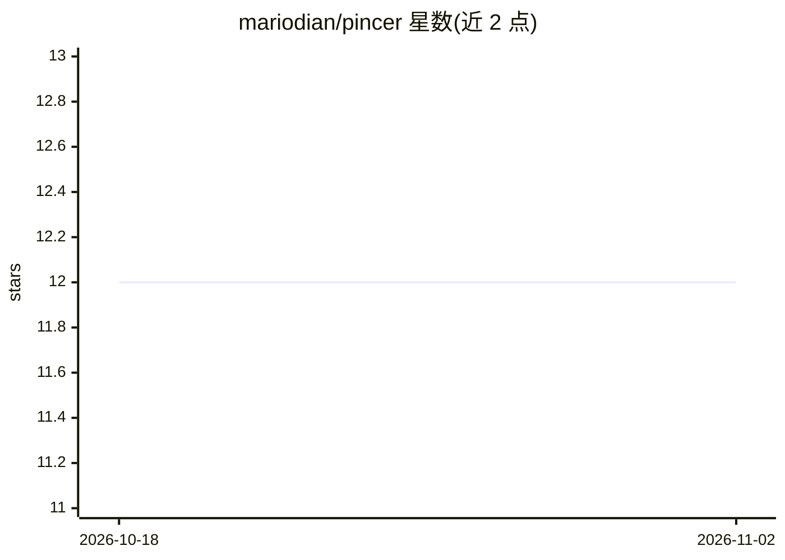

# mariodian/pincer

⭐ 12 · TypeScript · MIT · 推送 2026-09-28 · [GitHub](https://github.com/mariodian/pincer) · 个人维护

**系统托盘级本地 AI agent 健康监控桌面应用**

面向运行多个本地 AI agent 的用户的多平台桌面监控工具：驻留系统托盘，展示 agent 健康状态、KPI 图表、响应时间历史、24h/7d 事件时间线与热力图，并可导出 HTML 报告。支持 OpenClaw、OpenCrabs、Hermes、OpenCode 及自定义 HTTP 健康端点；数据以 SQLite 存储，跨 macOS/Windows/Linux。附带后台守护进程 pincerd（macOS arm64、Linux x86_64），在桌面应用关闭时持续采集。限制：自定义托盘菜单与原生 vibrancy 仅 macOS 可用。

## 筛选速览

| 维度 | 判定 | 备注 |
|---|---|---|
| AI 角色 | `ai-ecosystem` | LLM/agent 周边工具 |
| 许可风险 | `permissive` | MIT |
| 部署形态 | `None` |  |
| 模型依赖 | — | README 未给出锁定关系 |
| 硬件要求 | — | 无带数字的原话,不猜 |
| 安装摩擦 | `low` | 无编译、无系统依赖或容器化 |
| 成熟度 | — | 结构信号不足 |

## 能力要点

- 系统托盘实时 agent 状态与仪表盘（KPI、响应时间历史）
- 24h/7d 事件时间线与热力图，per-agent 在线率 HTML 报告
- 支持 OpenClaw/OpenCrabs/Hermes/OpenCode 及自定义 HTTP 健康端点
- pincerd 后台守护进程在桌面应用关闭时持续采集（macOS arm64、Linux x86_64）

## 适用场景

- 同时运行多个本地 AI agent 时在系统托盘查看健康与状态
- 回顾 agent 过去 24 小时/7 天的事件与响应时间趋势
- 导出 per-agent 在线率报告

## 场景标签

`LLM 可观测性` · 领域:评测与运维

## 证据(README 行号)

> L4: Desktop monitoring for local AI agents. Check health, status, and charts from your system tray, without leaving your
> L60: - **Agent support**: OpenClaw, OpenCrabs, Hermes, OpenCode, and custom HTTP health endpoints

## 星数曲线

2026-10-18 12 → 2026-11-02 12（+0）

---
*卡片 v1 · prompt 1.4 · 生成 2026-11-01 · 置信度 high · 依据 README sha `916f358826e3` · [字段定义](../../DATASET.md)*
