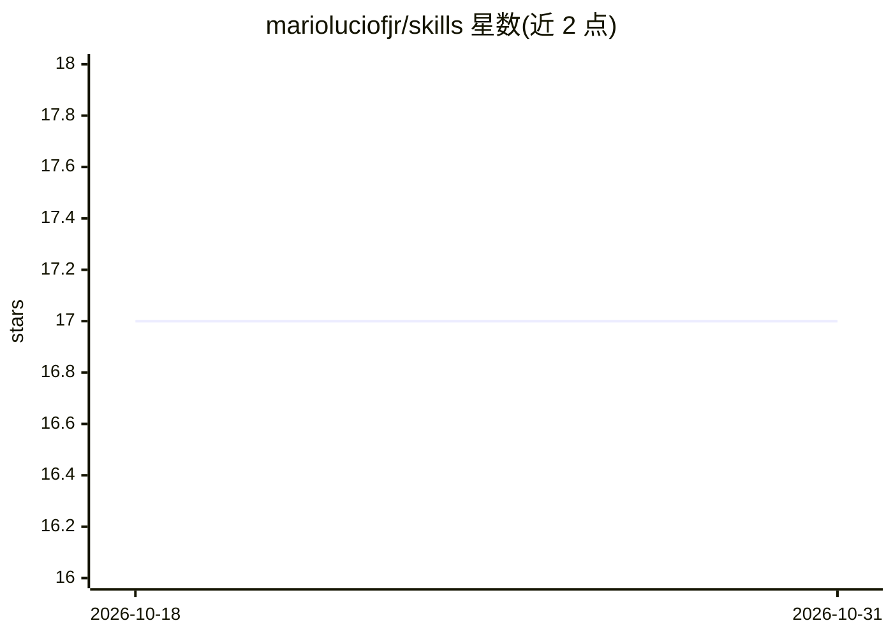

# marioluciofjr/skills

⭐ 17 · Python · Apache-2.0 · 推送 2026-10-26 · [GitHub](https://github.com/marioluciofjr/skills) · 个人维护

**个人维护的 agent 技能集合，供 Claude/Gemini 等系统使用**

作者个人编写的 35 个技能（skill）集合，每个文件夹对应一个技能，涵盖角色扮演提示、SWOT 分析、论文摘要、巴西个人所得税（MEI IRPF）、CDI 计算器、Mermaid 图表生成等任务。README 给出在 Claude、Gemini App、Antigravity 三种系统中上传/安装技能的分步说明，其中 Antigravity 路径通过 npx skills add 命令安装。技术栈为 Python、YAML、Markdown。许可证声明处存在 Apache 2.0 与 MIT 两种表述（L5 与 L127）。

## 筛选速览

| 维度 | 判定 | 备注 |
|---|---|---|
| AI 角色 | `ai-knowledge` | 知识聚合/清单类 |
| 许可风险 | `permissive` | Apache-2.0 |
| 部署形态 | `library` | 以包/库形式分发 |
| 模型依赖 | locked-api |  |
| 硬件要求 | — | 无带数字的原话,不猜 |
| 安装摩擦 | `low` | 无编译、无系统依赖或容器化 |
| 成熟度 | — | 结构信号不足 |

## 能力要点

- 35 个技能文件夹，每个对应一个独立技能
- 提供 Claude、Gemini App、Antigravity 三种安装路径的分步说明
- Antigravity 路径通过 npx skills add 命令行安装
- 技能用 Python、YAML、Markdown 编写

## 适用场景

- 为 Claude 或 Gemini App 上传个人技能执行特定任务
- 在 Antigravity 等 agent 系统中按需安装仓库中的技能
- 参考技能文件夹结构学习编写自定义技能

## 场景标签

`提示工程` · 领域:Agent 开发

## 证据(README 行号)

> L15: Este repositório reúne variadas skills para serem utilizadas em sistemas agênticos. Para saber mais detalhes sobre 
> L18: Cada pasta é uma skill diferente. Para baixar os arquivos .ZIP de maneira separada, só acessar os links abaixo:

## 星数曲线

2026-10-18 17 → 2026-10-31 17（+0）

---
*卡片 v1 · prompt 1.4 · 生成 2026-10-29 · 置信度 mid · 依据 README sha `2e17a3127a0d` · [字段定义](../../DATASET.md)*
