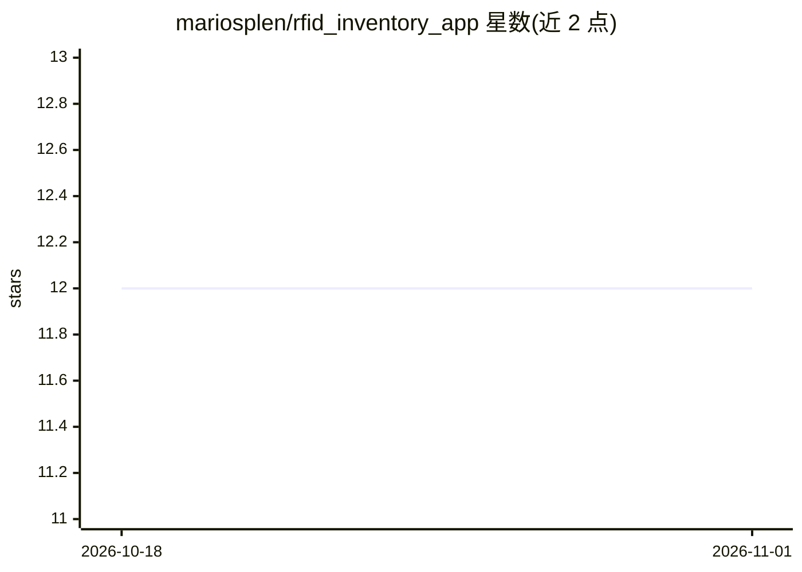

# mariosplen/rfid_inventory_app

⭐ 12 · Dart · 推送 2026-03-29 · [GitHub](https://github.com/mariosplen/rfid_inventory_app) · 个人维护

**RFID+AI 辅助库存管理应用：手机扫码拍照自动录入物品**

本科毕业设计项目：Flutter 移动应用（Android/iOS）结合 UHF RFID 硬件与 Google Gemini API 做库存管理。硬件侧由 Raspberry Pi 运行 Python Tornado WebSocket 服务，读取 Impinj Speedway R420 标签 EPC 并在局域网广播；应用侧实时接收标签数据、关联库存条目，拍照后调用 Gemini 自动填充名称/类别/标签/颜色。数据用 Hive 本地存储，Firebase 用于后端/认证。需要自备 RFID 读写器与树莓派。

## 筛选速览

| 维度 | 判定 | 备注 |
|---|---|---|
| AI 角色 | `ai-enhanced` | 去掉 AI 部分产品仍成立 |
| 许可风险 | `none` | — |
| 部署形态 | `None` |  |
| 模型依赖 | — | README 未给出锁定关系 |
| 硬件要求 | — | 无带数字的原话,不猜 |
| 安装摩擦 | `low` | 无编译、无系统依赖或容器化 |
| 成熟度 | — | 结构信号不足 |

## 能力要点

- WebSocket 实时接收 RFID 标签（Impinj R420 + Raspberry Pi）
- 拍照调用 Gemini 自动填充物品名称、类别、标签、颜色
- Hive 本地 NoSQL 离线存储，核心功能不依赖云端
- 按类别/标签/颜色过滤并标记物品检出状态

## 适用场景

- 仓库或零售场景实时盘点带 RFID 标签的物品
- 拍照快速录入物品信息到库存系统
- 跟踪物品是否在读写器检测范围内

## 场景标签

`多模态` · 领域:感知与多模态

## 证据(README 行号)

> L6: A Flutter mobile application that combines **UHF RFID** hardware with **Google Gemini AI** to automate inventory man
> L13: |🤖 **AI item identification**|Take a photo of any object — Google Gemini auto-fills name, category, tags, and color

## 星数曲线

2026-10-18 12 → 2026-11-01 12（+0）

---
*卡片 v1 · prompt 1.4 · 生成 2026-11-01 · 置信度 high · 依据 README sha `a925b9444cb4` · [字段定义](../../DATASET.md)*
