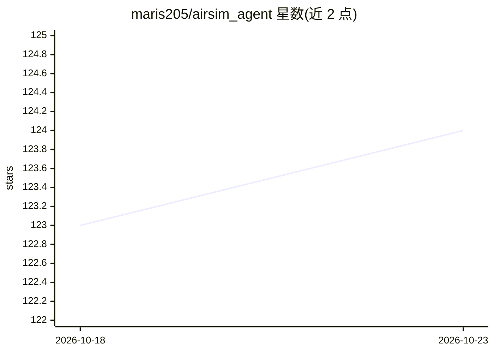

# maris205/airsim_agent

⭐ 124 · Jupyter Notebook · 推送 2026-06-01 · [GitHub](https://github.com/maris205/airsim_agent) · [官网](https://airgpt.cloud/) · 个人维护 · 中文 README

**无人机+大模型入门课程：AirSim 仿真实战教程**

以 AirSim 仿真平台为载体的无人机大模型入门课程，覆盖提示词控制、多模态视觉、Agent 框架（Smolagents）、语音交互、多 Agent 协同（CrewAI）、视觉语言导航（openVLA）与世界模型（DreamerV3）八个章节。统一使用 Python 接口，AirSim API 封装为易用类，每个模块提供最小可运行实例与 notebook，代码 100% 开源。面向计算机、电子、控制、无人机领域科研人员与学生。以仿真为主，真实硬件部署另设课程。

## 筛选速览

| 维度 | 判定 | 备注 |
|---|---|---|
| AI 角色 | `ai-knowledge` | 知识聚合/清单类 |
| 许可风险 | `none` | — |
| 部署形态 | `library` | 以包/库形式分发 |
| 模型依赖 | — | README 未给出锁定关系 |
| 硬件要求 | — | 无带数字的原话,不猜 |
| 安装摩擦 | `low` | 无编译、无系统依赖或容器化 |
| 成熟度 | — | 结构信号不足 |

## 能力要点

- 八个章节覆盖提示词/多模态/Agent/多Agent/VLN/世界模型方向
- AirSim API 封装为 Python 易用类，每模块带最小可运行实例
- AirSim Python SDK 已内置于 external-libraries/
- 每个章节目录自带封装脚本与 settings.json，可独立运行

## 适用场景

- 无人机大模型方向的科研入门学习
- 按章节复现感知-决策-控制全链路仿真实验
- 参加大模型相关竞赛的课程项目基础

## 场景标签

`教程课程` · 领域:学习与行业

## 证据(README 行号)

> L17: 我们结合无人机+大模型相关的最新论文，做了这样一个课程，基本覆盖了基于提示词的，agent的，多agent，多模态识别等几个主要的无人机大模型应用方向，可以作为无人机大模型入门学习课程。
> L19: 本课程作为一个领域入门课程，以仿真为主,后续会另外设置专门的硬件部署课程。
> L133: 上面就是课程的全部内容，会动态更新，根据大家反馈不断改进，力争打造一个“无人+大模型"的入门级精品课程。

## 星数曲线

2026-10-18 123 → 2026-10-23 124（+1）

---
*卡片 v1 · prompt 1.4 · 生成 2026-10-23 · 置信度 mid · 依据 README sha `8ae1e96b6561` · [字段定义](../../DATASET.md)*
