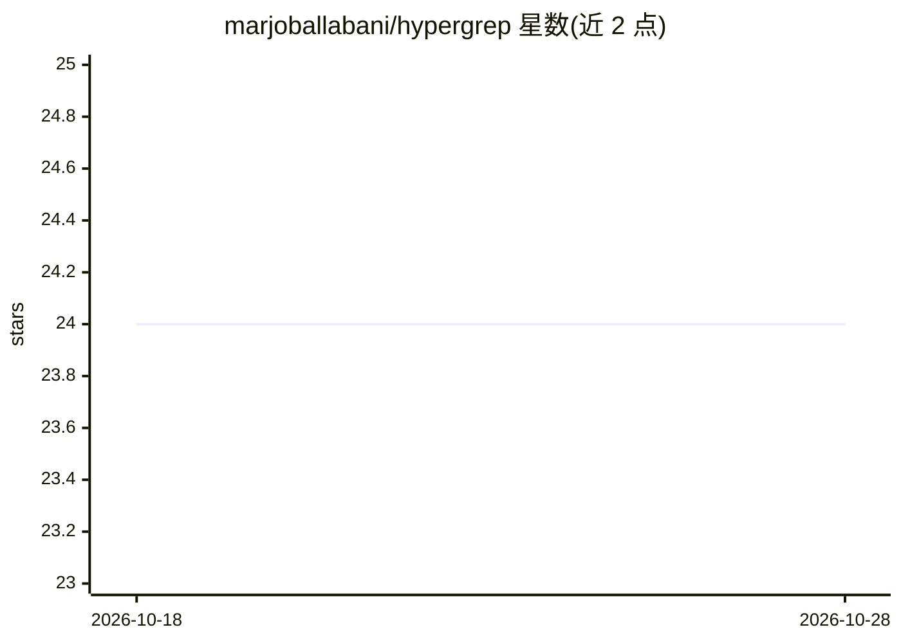

# marjoballabani/hypergrep

⭐ 24 · Rust · MIT · 推送 2026-03-29 · [GitHub](https://github.com/marjoballabani/hypergrep) · 个人维护

**面向 AI 编程代理的代码库结构化搜索引擎，降低 token 消耗**

用 Rust 编写的 CLI/守护进程工具，替代 grep/ripgrep 供 AI 编程代理调用：基于 trigram 索引做文本搜索，用 tree-sitter 做 8 种语言的结构化搜索（返回完整函数体）、调用图查询（--callers/--callees）、影响分析（--impact）、Bloom 过滤器存在性检查（--exists）、代码库压缩摘要（--model）与 token 预算裁剪（--budget）。提供 Claude Code/Cursor/Copilot/Windsurf 的配置模板生成脚本。冷启动约 800ms，超过 1 万文件的代码库需守护进程模式；调用图为静态分析，动态分发不解析。

## 筛选速览

| 维度 | 判定 | 备注 |
|---|---|---|
| AI 角色 | `ai-ecosystem` | LLM/agent 周边工具 |
| 许可风险 | `permissive` | MIT |
| 部署形态 | `desktop` | 安装包/桌面程序 |
| 模型依赖 | — | README 未给出锁定关系 |
| 硬件要求 | — | 无带数字的原话,不猜 |
| 安装摩擦 | `medium` | 含编译或系统依赖之一 |
| 成熟度 | — | 结构信号不足 |

## 能力要点

- tree-sitter 结构化搜索返回完整函数体，支持 8 种语言
- 调用图查询与多深度影响分析（WILL BREAK/MAY BREAK/REVIEW 分级）
- Bloom 过滤器存在性检查（--exists，NO 结果零假阴性）
- 三层语义压缩与 token 预算裁剪输出

## 适用场景

- 让 Claude Code/Cursor 等 AI 代理用更少 token 理解大型代码库
- 修改代码前查询调用方与潜在影响范围
- 快速确认项目是否使用了某项技术（如 Redis）

## 场景标签

 · 领域:开发者工具/代码智能

## 证据(README 行号)

> L7: **A codebase intelligence engine for AI coding agents.**
> L115: ## AI agent setup
> L123: This creates config files for Claude Code, Cursor, Copilot, and Windsurf. Your agents will automatically use hyper

## 星数曲线

2026-10-18 24 → 2026-10-28 24（+0）

---
*卡片 v1 · prompt 1.4 · 生成 2026-10-27 · 置信度 high · 依据 README sha `e3988e8e938a` · [字段定义](../../DATASET.md)*
