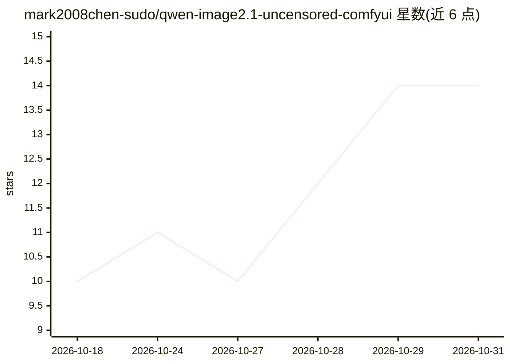

# mark2008chen-sudo/qwen-image2.1-uncensored-comfyui

⭐ 14 · Python · MIT · 推送 2026-09-21 · [GitHub](https://github.com/mark2008chen-sudo/qwen-image2.1-uncensored-comfyui) · [官网](https://huggingface.co/abenzerps/Qwen-Image-2.1-Uncensored-GGUF) · 个人维护 · 中文 README

**ComfyUI 上部署 Qwen-Image-2.1 Uncensored GGUF 的一站式配套套件**

面向 ComfyUI 用户提供 Qwen-Image-2.1 Uncensored GGUF（文生图与图像编辑）的完整部署配套：开箱即用的 t2i 工作流 JSON、ComfyUI-GGUF 节点的架构与加载器补丁、以及修复 Q8_0 一维张量错误量化（[136] vs [128] 报错）的 14 秒无损修复工具，附权重下载脚本与踩坑文档。实测配置为 8 GB 显存 + 32 GB 内存（RTX 5060 Laptop），512×512 约 32 秒。模型权重（32.74 GB）不随仓库分发，需从 Hugging Face 上游获取；使用 GGUF 需 ComfyUI ≥ 0.37.0、PyTorch ≥ 2.6、ComfyUI-GGUF 节点（city96 需打补丁，leejet 分支原生支持）。

## 筛选速览

| 维度 | 判定 | 备注 |
|---|---|---|
| AI 角色 | `ai-ecosystem` | LLM/agent 周边工具 |
| 许可风险 | `permissive` | MIT |
| 部署形态 | `desktop` | 安装包/桌面程序 |
| 模型依赖 | — | README 未给出锁定关系 |
| 硬件要求 | `gpu-8g` | |
| 安装摩擦 | `low` | 无编译、无系统依赖或容器化 |
| 成熟度 | — | 结构信号不足 |

## 能力要点

- 提供 t2i 与图像编辑的 ComfyUI 工作流及 ComfyUI-GGUF 架构补丁
- Q8_0 量化缺陷修复器：scan/fix/verify 三步，14 秒、零额外下载、体积仅 +31.5 KB
- 8 GB 显存 / 32 GB 内存实测参数表与已知问题速查表
- 权重下载脚本支持国内镜像（--mirror）

## 适用场景

- 在 8 GB 低显存机器上本地离线跑 Qwen-Image-2.1 GGUF 出图
- 修复官方 GGUF 包导致的 weight shape [136] vs [128] 报错
- 排查 ComfyUI-GGUF 多副本、架构未识别等部署问题

## 场景标签

`图像生成` `模型量化` · 领域:内容生成

## 证据(README 行号)

> L3: > **Qwen-Image-2.1 Uncensored (GGUF) — ComfyUI deployment kit**
> L31: 在 **ComfyUI** 上跑 **Qwen-Image-2.1 Uncensored GGUF** 的完整配套。原模型发布包开箱即用会撞上**三个坑**，本仓库把坑和补丁一并解决：
> L99: ### 第 3 步 · 修复 Q8_0 量化缺陷 ⭐

## 星数曲线

2026-10-18 10 → 2026-10-31 14（+4）

---
*卡片 v1 · prompt 1.4 · 生成 2026-10-31 · 置信度 high · 依据 README sha `8ca9299670e7` · [字段定义](../../DATASET.md)*
