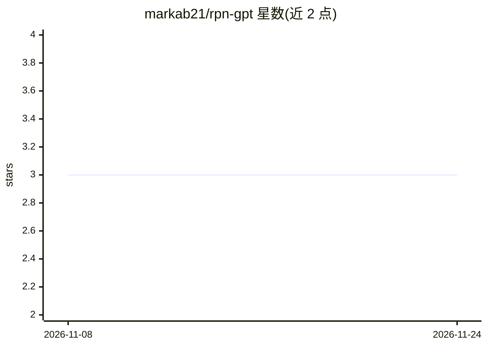

# markab21/rpn-gpt

⭐ 3 · Python · MIT · 推送 2026-11-07 · [GitHub](https://github.com/markab21/rpn-gpt) · [官网](https://huggingface.co/collections/markab/rpn-gpt-6aee2a080aedf1d6e4694814) · 个人维护

**把精确 Forth 栈机编译进模型权重，让 LLM 免工具调用做精确算术**

研究项目：在 Nemotron 3.5 Lightning（30B/3B 激活）权重内嵌入一个由 Python 程序逐权重计算的 Mamba-2 小内核，构成 Forth 栈机；再训练 LoRA 适配器教模型何时、如何写 Forth 程序，程序由内核在同一 token 流内执行并把结果作为后续 token 输出，无需外部工具调用。内核结果 20 位数字以内精确（与 Python 规范机对齐），代价是速度：每步一次前向。README 声明内核仅在特定 vLLM 版本与固定设置下精确。

## 筛选速览

| 维度 | 判定 | 备注 |
|---|---|---|
| AI 角色 | `ai-native` | 本体是模型或模型工具 |
| 许可风险 | `permissive` | MIT |
| 部署形态 | `library` | 以包/库形式分发 |
| 模型依赖 | local-ok | 支持本地模型 |
| 硬件要求 | — | 无带数字的原话,不猜 |
| 安装摩擦 | `low` | 无编译、无系统依赖或容器化 |
| 成熟度 | — | 结构信号不足 |

## 能力要点

- 内核权重由 kernel/sp_kernel.py 程序化生成，618 测试用例 0 错
- 模型写 Forth 程序、内核在同流执行，生成不中断、无外部沙箱
- 600 道留出题上训练模型 92.1% vs 原始 79.1%
- 提供 vLLM/BF16、GGUF/Ollama、MLX 4-bit 多种部署形态

## 适用场景

- 需要长链精确整数运算且不愿走工具调用的推理实验
- 研究权重内嵌计算结构与后训练结合的方法
- 在 80GB+ GPU 上自建该模型服务，或笔记本上跑 Python 规范机

## 场景标签

`微调` · 领域:训练与推理

## 证据(README 行号)

> L7: Language models make mistakes in long exact arithmetic. The usual fix is a tool call: the model writes code, generat
> L9: Nobody trained the computer. A Python program calculated each of its weights. We call it the kernel. The language mo
> L79: |Does training help?|On 600 held-out problems: stock Lightning 79.1%, trained model (round 7) 92.1%, **+13.0 points

## 星数曲线

2026-11-08 3 → 2026-11-24 3（+0）

---
*卡片 v1 · prompt 1.4 · 生成 2026-11-21 · 置信度 mid · 依据 README sha `de3accacada9` · [字段定义](../../DATASET.md)*
