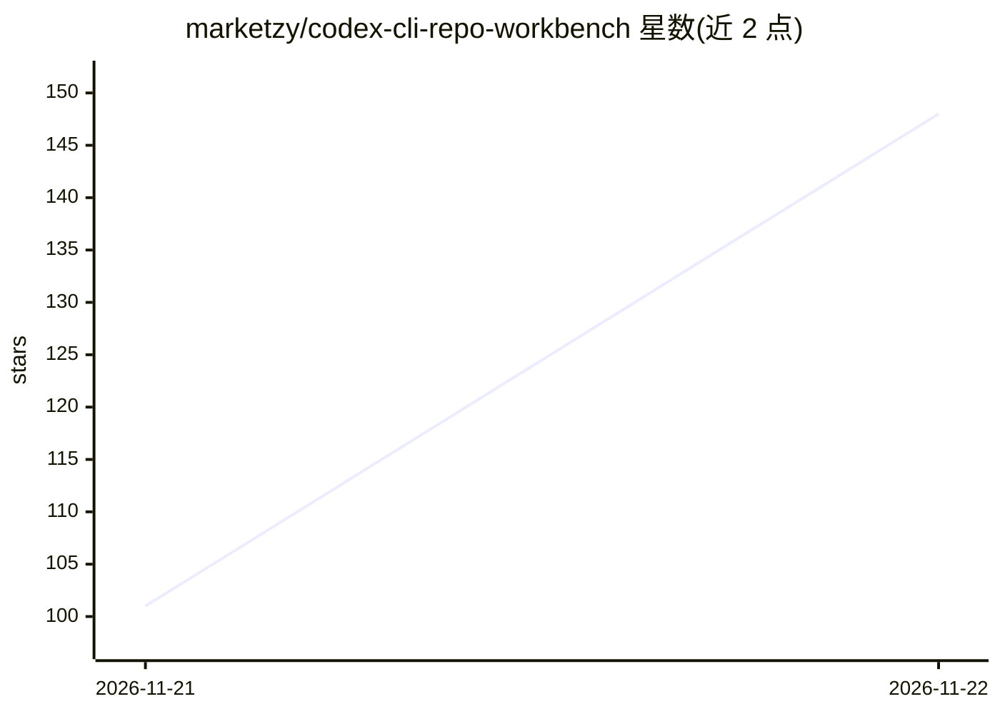

# marketzy/codex-cli-repo-workbench

⭐ 148 · HTML · MIT · 推送 2026-11-21 · [GitHub](https://github.com/marketzy/codex-cli-repo-workbench) · 个人维护

**开发者在终端内检查与维护本地 Git 仓库的 PowerShell 工具**

面向 Windows 的命令行仓库工作台：以单一可脚本化接口检查与操作本地 Git 仓库，提供仓库概览、清理建议、文件浏览与 diff、任务清单、批量计划与会话历史回放等模块。作为编排层调用 Codex CLI，将仓库内容组装为提示传入并原样呈现输出；默认只读，写操作需显式 --apply 标志，结构化输出适合管道与 CI。

## 筛选速览

| 维度 | 判定 | 备注 |
|---|---|---|
| AI 角色 | `ai-ecosystem` | LLM/agent 周边工具 |
| 许可风险 | `permissive` | MIT |
| 部署形态 | `None` |  |
| 模型依赖 | — | README 未给出锁定关系 |
| 硬件要求 | — | 无带数字的原话,不猜 |
| 安装摩擦 | `low` | 无编译、无系统依赖或容器化 |
| 成熟度 | — | 结构信号不足 |

## 能力要点

- 命令计划机制：记录可执行文件、参数、工作目录与环境覆盖，由单一 runner 顺序执行
- 非破坏性默认：写操作需显式标志，否则只读
- 机器可读与人类可读输出分离，退出码稳定可映射
- 会话历史支持回放与调整后重跑

## 适用场景

- 长时间改动后整理工作树并生成干净的提交
- 审计并复现之前执行的维护操作序列
- 团队统一终端输出与清理行为并接入脚本

## 场景标签

 · 领域:开发者工具/仓库维护

## 证据(README 行号)

> L35: Codex Cli Repo Workbench operates as a thin orchestration layer over the target repository and the Codex CLI. On in
> L43: Scope and limits are deliberate. The tool does not manage Codex CLI installation, versioning, or authentication; it

## 星数曲线

2026-11-21 101 → 2026-11-22 148（+47）

---
*卡片 v1 · prompt 1.4 · 生成 2026-11-21 · 置信度 high · 依据 README sha `d7c236ca936f` · [字段定义](../../DATASET.md)*
